# CRAFT resync: design for HomeBlocks

> **Status.** Design proposal, November 2026. It covers the resync path that HomeBlocks' `CraftReplDev` and the
> CRAFT peer plane need, measured against the protocol in the wiki and against the code on `dev/v6.x` (§3).
> **Ownership.** Login orchestration (S7) and the peer transport / CraftConnector (S9) are owned by another
> engineer; this document states the contracts it needs from them (§4.6, §8). The UBD-side changes live in the
> `craft_client` repo.
> **Sources.** The protocol is [CRAFT Design](https://github.com/eBay/HomeBlocks/wiki/CRAFT-Design) (§ *Resync / catch-up: the FetchData loop*,
> § *Reconfiguration*, deep-dive 1), and its store binding is
> [CRAFT on HomeBlocks](https://github.com/eBay/HomeBlocks/wiki/CRAFT-on-HomeBlocks) (§ *Journal reclaim and the
> returning-voter snapshot trigger*, § *Reconfiguration mechanics*). The wiki is the source of truth for *what*
> resync guarantees. This page covers *how* HomeBlocks delivers it, and §3 lists what the code does today
> and where it disagrees with the design.

## Overview: resync by case

This part describes resync **case by case, at the level of who talks to whom**. Each case has a short flow, a
sequence diagram, and what it guarantees. The mechanisms, invariants, wire formats, defects and risks behind them
are in the detailed design that follows.

**Terminology.** **UBD** is the CRAFT client (the ublk driver that assigns dLSNs, sends every write to all
replicas and routes reads). The **application** is whatever receives the acknowledgement: XFS and above. A
**replica** is a CRAFT partition replica on a **BM**.

**Who drives resync.** Resync is driven by the **CRAFT BM side**: the leader BM decides when, and the data moves
BM to BM. UBD does not drive it and does not carry resync data. It only remembers which replica missed what,
routes reads around it, and reports its commit point on its normal writes and keep-alives.

**Background in four sentences.** UBD sends every write directly to all replicas and calls it durable
once a **quorum** (2 of 3) has stored it. RAFT runs alongside but carries only small control entries (who the
writer is, how far everyone should be), never the data. So a replica can fall behind on data while being fully up
to date on RAFT, and closing that gap replica-to-replica is **resync**. Resync has two jobs: copy durable writes to every
replica that lacks them, and, at login only, decide the fate of writes that never reached a quorum (*durable* or
*void*).

| Case | When it happens |
|---|---|
| 1. One replica misses a write | A write reaches 2 of 3 replicas: the application gets success, one replica lags |
| 2. Healing a lagging replica | A replica missed some writes; they are still in the other replicas' journals |
| 3. A write fails | Fewer than 2 of 3 replicas stored it: the application gets an error |
| 4. Login | A new UBD takes over the volume |
| 5. Login aborted | The leader crashes in the middle of a login |
| 6. Snapshot for a replica past retention | The writes a replica needs are no longer in any journal |
| 7. New member joins | A replica is added or replaced |
| 8. Snapshot source fails | The replica serving a snapshot dies mid-transfer |
| 9. UBD disappears | UBD stops without logging out |

### Case 1: One replica misses a write

UBD sends every write to all three replicas and reports success to the application once **two** have
stored it. If the third misses it (a timeout, a slow disk), the write is still durable. UBD only has to
remember **which replica missed what**, and keep reads of that data away from it.

#### Flow

1. The write reaches two replicas, so the application gets success.
2. UBD records the miss in its per-replica map: *replica C, write 101, LBA range*.
3. A read of that range goes only to replicas that hold write 101. Every other range can still be read from
   replica C.
4. Replica C heals in the background, driven by the BMs (Case 2); UBD takes no part in it. When its reply shows its commit point past 101, UBD drops
   the entry, and C serves that range again.

The same map covers a replica that is **catching up through the log** or **receiving a snapshot** (Case 6):
whatever it does not hold yet is routed around, and it rejoins range by range as its commit point advances.

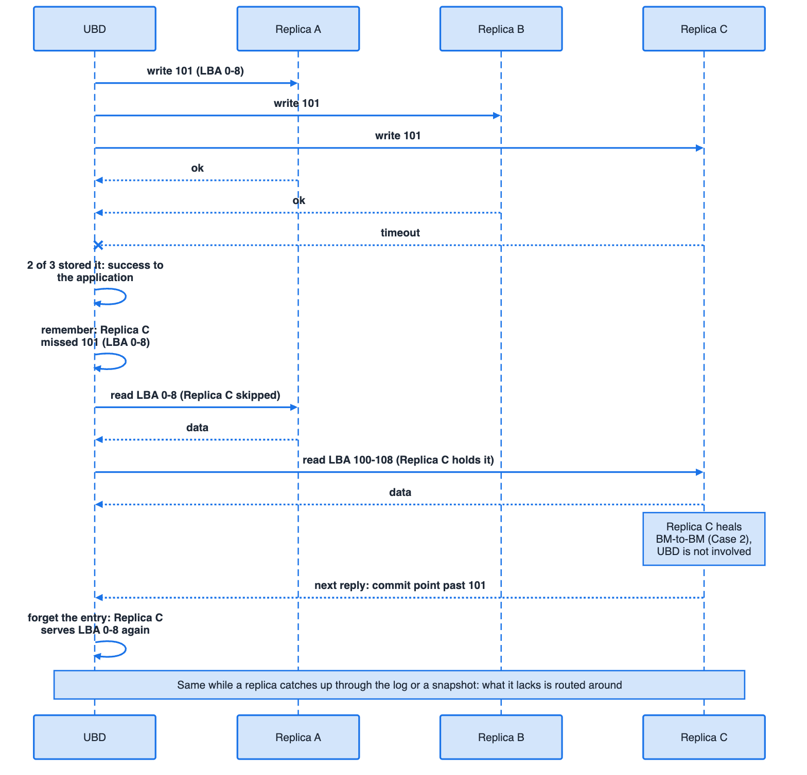

<details><summary>Diagram source (Mermaid)</summary>

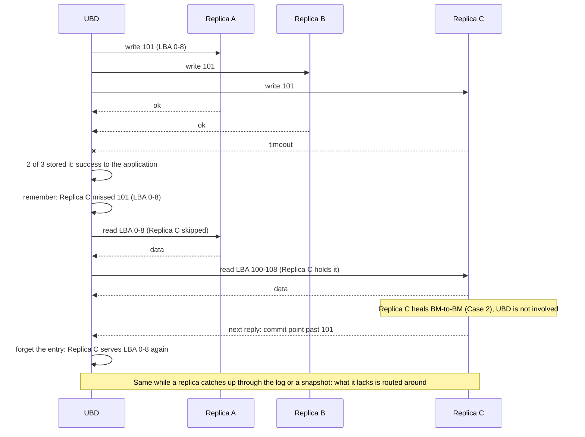

</details>

*Figure 1: One replica misses a write, sequence diagram*

#### Guarantees

- **No error and no read stall:** the application sees success, and reads keep flowing from replicas that hold
  the data.
- **Reads stay correct:** a replica is never asked for data it does not hold.
- **Bounded:** entries are kept as merged LBA ranges and removed once the replica's commit point passes them. If
  the map overflows, that replica is skipped for all reads until it catches up.
- **Resync is still needed:** the map only keeps reads away from the gap. Healing removes it, so the replica can
  apply past it, journals can be cleaned up, and the write is back to three copies.

### Case 2: Healing a lagging replica

A replica that misses some writes (a dropped connection, a slow disk) keeps serving every range it holds, and the
UBD simply routes reads for the missed ranges elsewhere. Healing brings it back in full. It is **driven by the
leader BM** on its own schedule; UBD does not request or drive it.

#### Flow

1. The leader BM periodically checks how far each replica is (every K writes or T seconds, and when UBD goes
   idle), up to the commit point UBD last reported on its normal traffic.
2. Every write up to that point is already durable on a quorum, so there is nothing to decide. The leader records
   the target through RAFT.
3. The lagging replica fetches the writes it is missing, in chunks, from the leader first and then from any other
   replica, and applies them in order.
4. Its next reply to UBD shows the higher commit point, and UBD routes reads to it again.

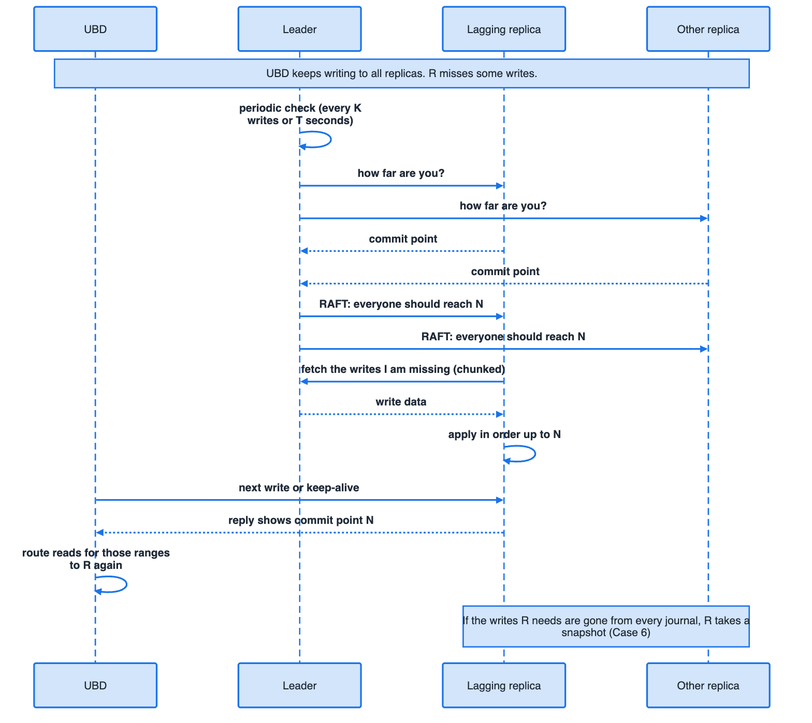

<details><summary>Diagram source (Mermaid)</summary>

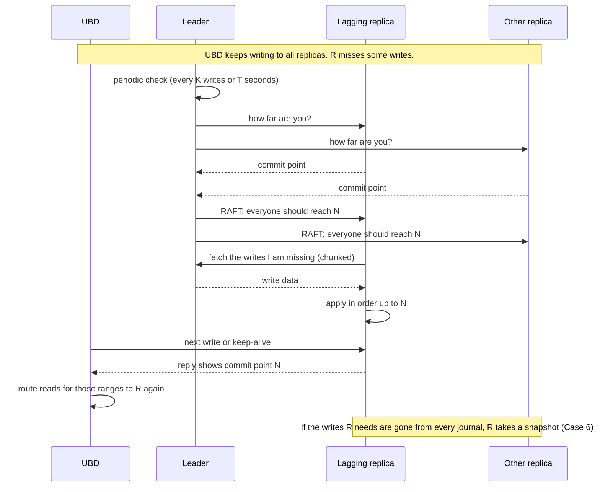

</details>

*Figure 2: Healing a lagging replica, sequence diagram*

#### Guarantees

- **Trigger:** BM-side only: periodic, or when UBD is idle (watchdog). Bounded by UBD's commit point, so writes still
  in flight are never touched.
- **Success:** the replica's commit point reaches the target and its reads come back.
- **Failure:** a fetch that keeps failing is retried with backoff. A fetch answered with "reclaimed" escalates to a
  snapshot (Case 6).
- **Fill only:** these rounds copy durable writes. They never mark a write Empty; that happens only at login.
- **Cost:** proportional to the number of writes missed; every version is copied, even overwritten ones.

### Case 3: A write fails

UBD reports a write error to the application **only when fewer than two of the three replicas stored it**. In
our deployment the application is XFS: on a write error it takes the filesystem offline, and the volume is then
detached. So a failed write is **not** completed or resolved during the session. UBD finishes the I/Os already
queued and detaches, and the failed slot is decided at the **next login**.

#### Flow

1. Write 101 reaches only one replica (C), so UBD returns an error to the application.
2. XFS goes offline. UBD finishes the remaining queued I/Os and is asked to unmount and detach the volume.
3. Until then nothing about slot 101 changes. It only holds the commit point, because replicas apply in order.
4. At the next login (Case 4) the leader decides slot 101 under the fence:
   - **a responding replica holds it**, so it is filled everywhere: the write completed late;
   - **no responding replica holds it** (for example C is down), so it is marked **Empty** (void), and C drops its
     copy when it rejoins.

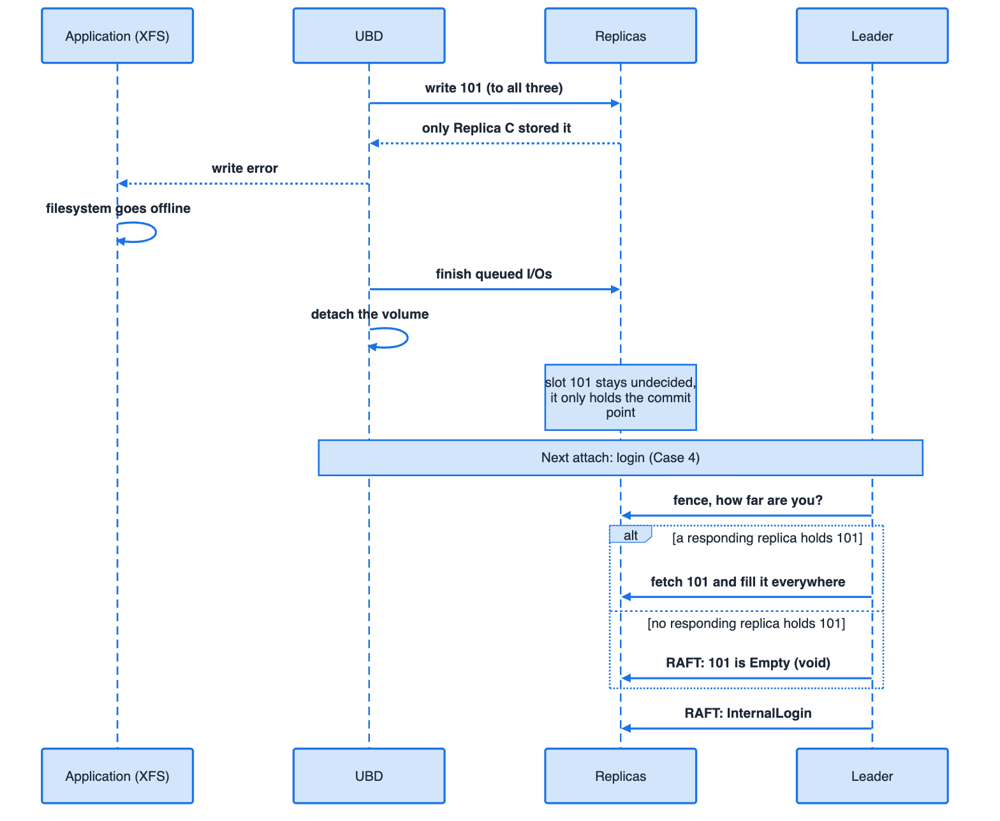

<details><summary>Diagram source (Mermaid)</summary>

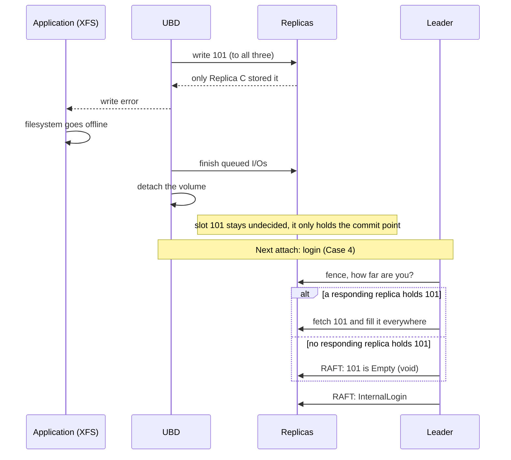

</details>

*Figure 3: A write fails and is resolved at the next login, sequence diagram*

#### Guarantees

- **Error only below a quorum:** one missed replica is Case 1, not an error.
- **No mid-session decision:** nothing is marked Empty while a UBD is writing, so an acknowledged write can never
  be voided by a race with resync. Every Empty decision happens at login, under the fence.
- **Either outcome is legal:** the application got an error, so the write may land late or be dropped.
- **Retries are bounded:** UBD does not retry a failed write forever. The error must reach the application.

### Case 4: Login

A new UBD (or the same one after a failover) takes over. Before the new session writes anything, every replica
must agree on a starting point, and the old session's UBD must be stopped so that none of its writes are acknowledged
and then lost.

#### Flow

1. **Pre-sync:** the leader catches up on what it is missing **without** stopping anyone, repeating until the
   remaining gap is small.
2. **Fence:** the leader stops the old session on every replica, itself included, and each replica reports the
   last write it holds. The highest one reported by a quorum becomes the starting point.
3. The leader fills the small remaining gap and records the starting point through RAFT.
4. The leader commits **InternalLogin** through RAFT. Each replica drops anything above the starting point and
   admits the new session in the same step. The fence lifts **only** here, or on an explicit abort (Case 5),
   never on a timer.
5. The new UBD starts writing just above the starting point.

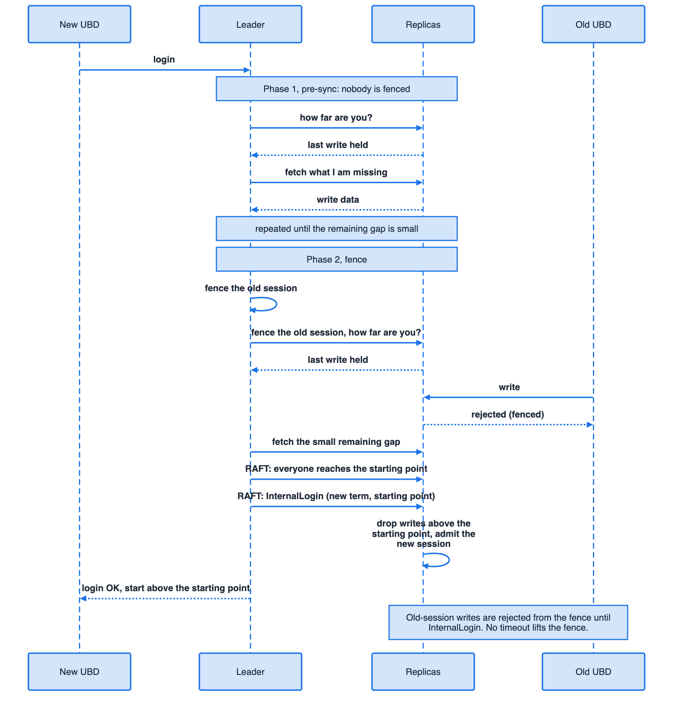

<details><summary>Diagram source (Mermaid)</summary>

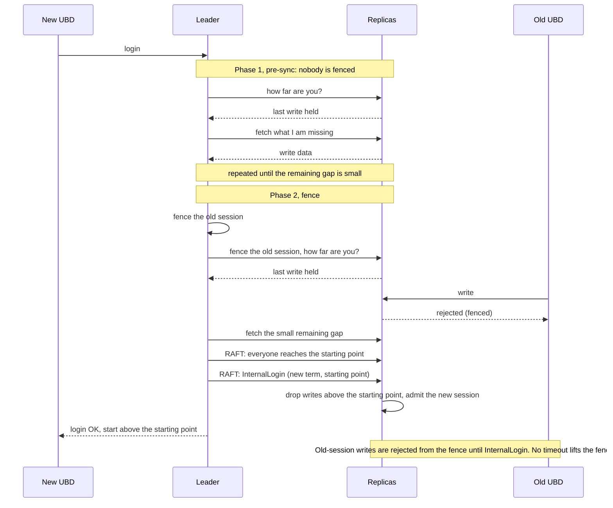

</details>

*Figure 4: Login with pre-sync and a fence that holds until commit, sequence diagram*

#### Guarantees

- **No acknowledged write is lost across a takeover.** Everything acknowledged before the fence is covered by
  the starting point, and nothing can be acknowledged after it.
- **Short fenced window:** the expensive catch-up happens in pre-sync, before anyone is fenced.
- **Cost of the safety:** between the fence and InternalLogin the replicas accept neither the old nor the new
  session. That is normally about two round trips.

### Case 5: Login aborted

If the leader crashes after fencing but before committing InternalLogin, the fence must not lift by itself (that
would reopen the window Case 4 closes). A new leader cleans up instead.

#### Flow

1. Leader 1 fences the replicas, then crashes.
2. The old session's UBD (the current owner, whose session was never torn down) keeps being rejected.
3. RAFT elects a new leader, which notices an unfinished login: a replica's fence is ahead of its session.
4. The new leader commits **LoginAborted** through RAFT, and the replicas lift the fence. The old session's UBD can
   write again, or a new login proceeds.

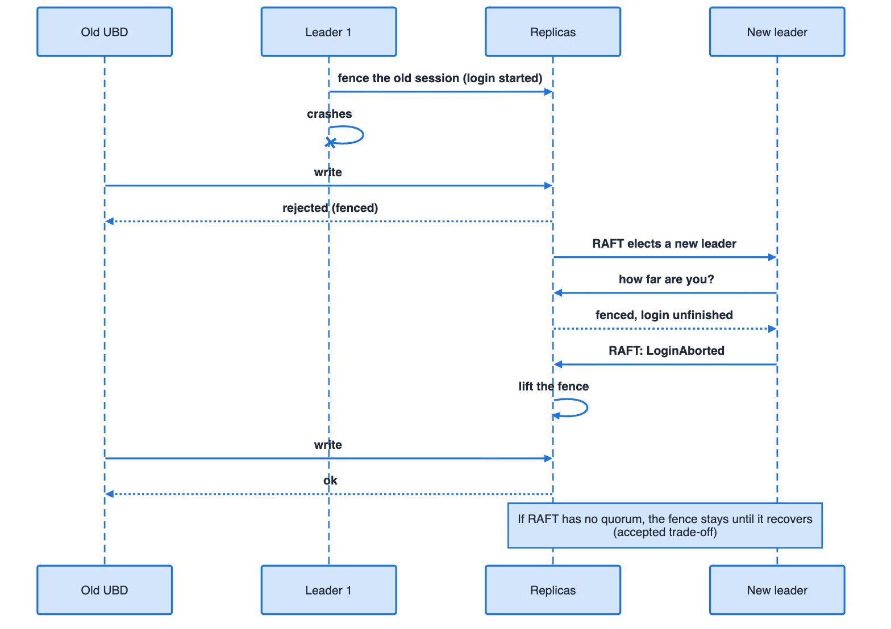

<details><summary>Diagram source (Mermaid)</summary>

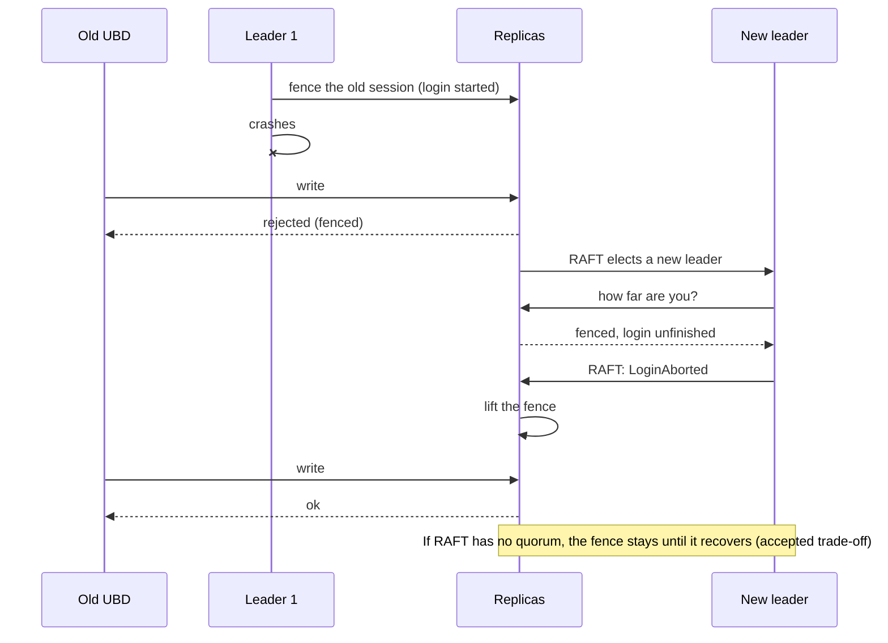

</details>

*Figure 5: Login aborted after the leader crashed, sequence diagram*

#### Guarantees

- **The fence ends only through a committed RAFT decision**: InternalLogin or LoginAborted, exactly one per login.
- **Trade-off:** the old session's UBD stays blocked while RAFT has no quorum. That happens only during a failover that
  was already under way.

### Case 6: Snapshot for a replica past retention

Journals are bounded. If a replica fell so far behind that the writes it needs were cleaned up everywhere, it
cannot heal through Case 2. It instead copies the whole volume state (the HomeBlocks B-tree with its data) from
one healthy replica, then replays that replica's journal from the snapshot point. This happens **directly between
the two replicas**; RAFT is not involved, so it works even for a replica that was online all along.

#### Flow

1. A fetch answers "reclaimed". The leader sets the replica's election priority to 0, so it cannot become leader
   while behind.
2. The replica picks a healthy source (any replica, preferably not the leader) and opens a snapshot session. The
   source freezes its B-tree at a point (`startLSN`) and keeps its journal from there, for as long as the session
   is alive.
3. The replica pulls the B-tree in chunks. Each chunk replaces one LBA range (data and holes) in its own B-tree.
   It keeps storing new UBD writes but does not apply them yet.
4. It fetches the source's journal from the snapshot point, closes the session, and resumes normal catch-up. The
   leader restores its priority.

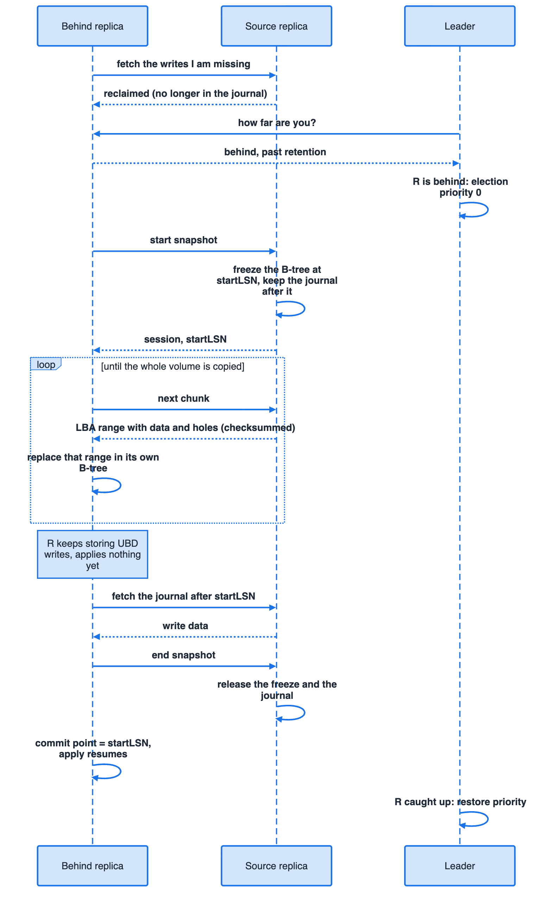

<details><summary>Diagram source (Mermaid)</summary>

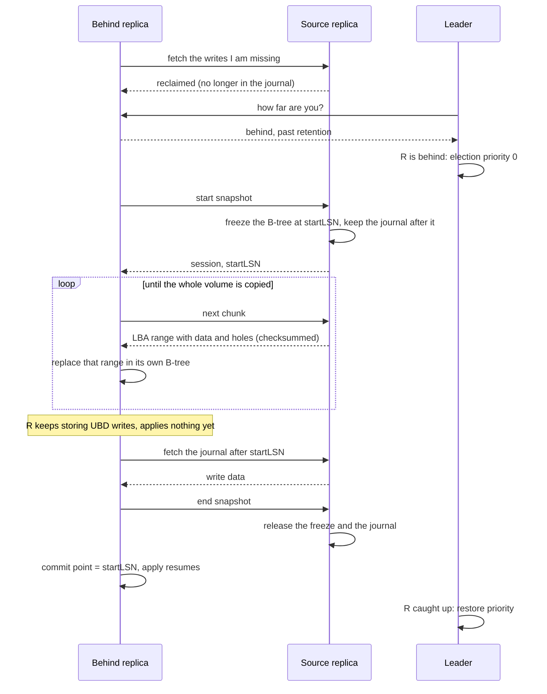

</details>

*Figure 6: Snapshot for a replica past retention (option b′), sequence diagram*

#### Guarantees

- **Works whatever the RAFT state:** triggered by the data ("reclaimed"), not by RAFT. That covers the replica that
  stayed online but fell behind on data.
- **No leader load required:** any healthy replica can be the source.
- **A dead receiver pins nothing for long:** the source keeps its journal under a lease that each chunk renews.
- **Cost:** proportional to the volume's mapped data, whatever the gap. Region-level deltas are a later
  optimization.

### Case 7: New member joins

A new or replacement replica starts empty. RAFT adds it as a non-voting learner. RAFT gives it the control state,
the data comes through the Case 6 stream, and it is promoted once it holds the data.

#### Flow

1. The leader adds the replica as a learner through RAFT and records the volume's current position as its promotion
   gate.
2. If the RAFT log it needs was compacted, RAFT sends a small snapshot with control state only (session, verdicts).
3. The replica's first fetch answers "reclaimed", so it copies the volume as in Case 6, then fetches the tail.
4. Once its commit point passes the gate, the leader promotes it to voter. UBD re-logs in and picks up the new
   member list.

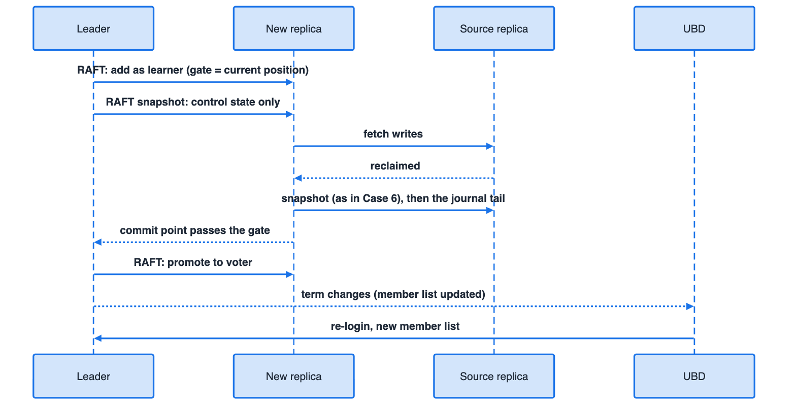

<details><summary>Diagram source (Mermaid)</summary>

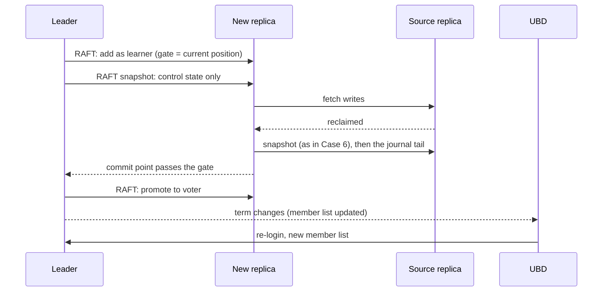

</details>

*Figure 7: New member joins, sequence diagram*

#### Guarantees

- **A replica votes only once it holds the data** up to the gate.
- **UBD never writes to a learner**, so the new replica pulls everything; it is never pushed.

### Case 8: Snapshot source fails

A snapshot can take hours, so the source may fail during it. The snapshot restarts from another source; nothing
needs cleaning up.

#### Flow

1. The source crashes mid-transfer. Its freeze and journal hold disappear with it.
2. The receiver's next chunk request fails, so it picks another source and starts a new session.
3. The new chunks replace every range, including those the first source had sent, so the result is consistent.
4. If the **receiver** crashes instead, it resumes the same session from its saved position, provided the source's
   lease has not expired.

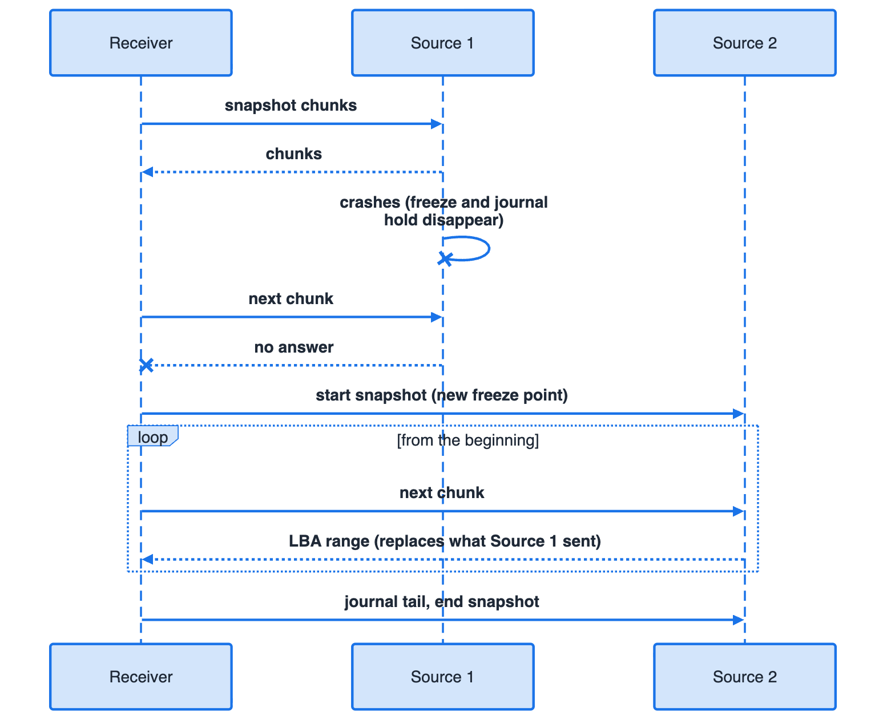

<details><summary>Diagram source (Mermaid)</summary>

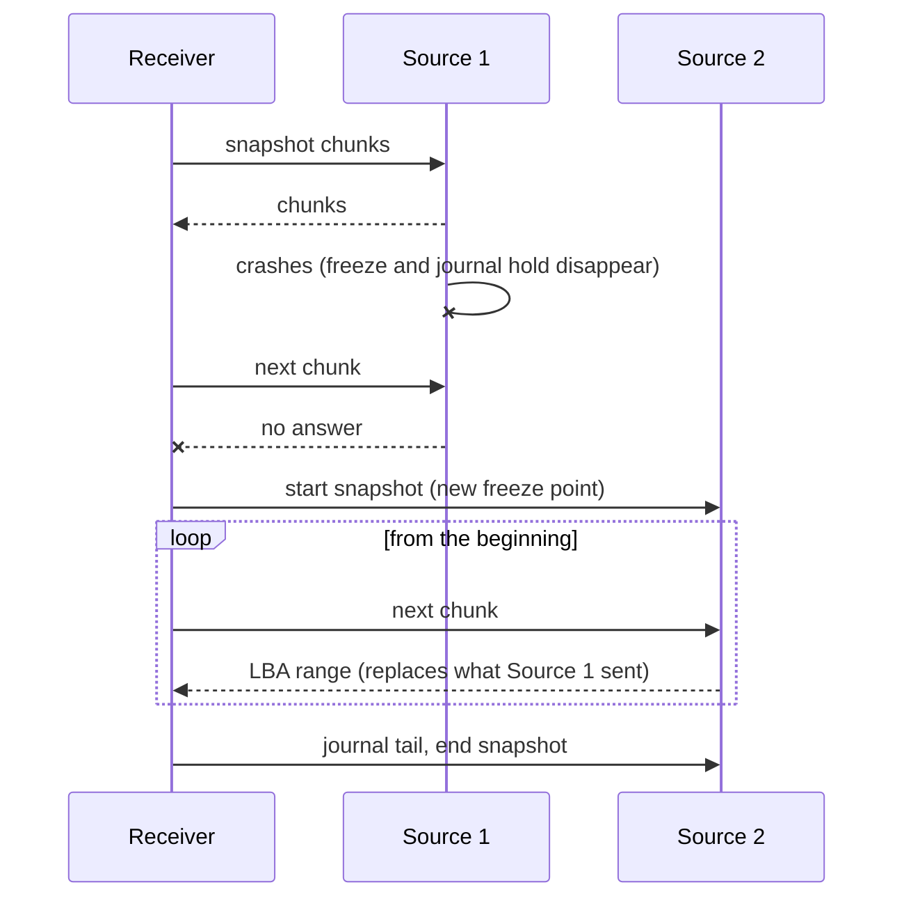

</details>

*Figure 8: Snapshot source fails, sequence diagram*

#### Guarantees

- **Always correct:** each chunk replaces its whole range.
- **Cost:** a source failure restarts the copy; resuming across sources is a later optimization.

### Case 9: UBD disappears

If UBD stops without logging out, the leader BM detects it through its lease, heals what
it safely can, and then takes over as a stand-in so that the replicas fully converge before the next attach.

#### Flow

1. Each BM keeps a lease that UBD's writes and keep-alives reset. BMs never ping UBD: UBD opens every
   connection. When the leader's lease sees no traffic for T (watchdog), it heals up to UBD's last reported
   commit point (Case 2).
2. When UBD's lease expires, the leader commits **InternalLogout** through RAFT. Replicas reject the old
   session from then on.
3. The leader acts as a stand-in for UBD: it runs a login without a UBD (Case 4), which converges every replica
   to one starting point.
4. It keeps healing laggards until a real UBD logs in.

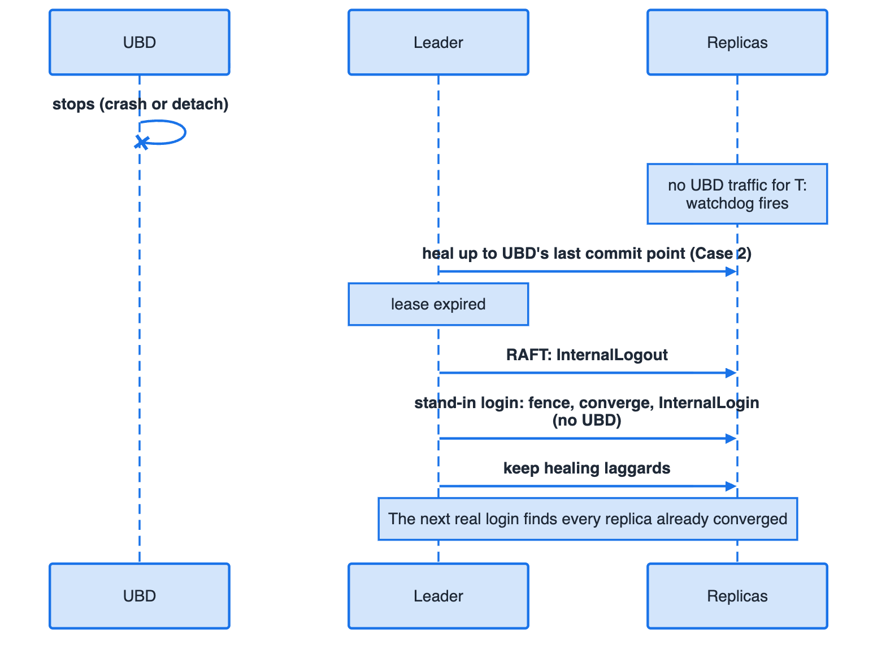

<details><summary>Diagram source (Mermaid)</summary>

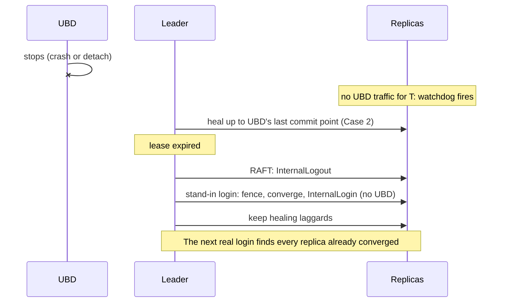

</details>

*Figure 9: UBD disappears, sequence diagram*

#### Guarantees

- **Healing never depends on UBD being alive.**
- **The stand-in uses the login path**, so it inherits Case 4's safety argument instead of needing its own.

### Decisions taken

| Topic | Decision | Rejected |
|---|---|---|
| Login fence (C1) | Lifts only on a committed InternalLogin or LoginAborted, with a pre-sync before fencing (Cases 4–5) | A timeout release, which loses acknowledged writes when a login is slow; relying on the attach layer alone |
| Snapshot path (C2) | Data streamed replica-to-replica over the CRAFT peer plane; RAFT carries control state only (Cases 6–8) | Keeping the bulk snapshot inside nuraft: remove and re-add, the `receiving_snapshot` flag, a leader-side fork API |
| Snapshot receive | Probably merge onto the existing B-tree, with range-replace chunks | Open question 9 |
| Failed writes | Error to the application, which (XFS) goes offline; the volume detaches and the slot is filled or marked Empty at the next login (Case 3) | UBD resending the write; a mid-session leader resolution round |
| Who drives resync | The CRAFT BM side (leader BM); data moves BM to BM | UBD driving or carrying resync |
| Region-level delta snapshots | Later optimization | — |

---

## Detailed design: contents

1. [What resync is for](#1-what-resync-is-for)
2. [Invariants resync must hold](#2-invariants-resync-must-hold)
3. [As-built: HomeBlocks `CraftReplDev` today](#3-as-built-homeblocks-craftrepldev-today)
4. [Design](#4-design)
   - 4.1 [Triggers and their safe targets](#41-triggers-and-their-safe-targets)
   - 4.2 [The leader's resolution round](#42-the-leaders-resolution-round)
   - 4.3 [Follower catch-up (SyncRSCommitLSN apply)](#43-follower-catch-up-syncrscommitlsn-apply)
   - 4.4 [Failed writes: resolved at login only](#44-failed-writes-resolved-at-login-only)
   - 4.5 [No mid-session verdicts](#45-no-mid-session-verdicts)
   - 4.6 [Login-time resync](#46-login-time-resync)
   - 4.7 [Peer-plane wire v2](#47-peer-plane-wire-v2)
   - 4.8 [Journal reclaim and the retention floor](#48-journal-reclaim-and-the-retention-floor)
   - 4.9 [Baseline resync (snapshot) and large gaps — option (b′)](#49-baseline-resync-snapshot-and-large-gaps--option-b)
   - 4.10 [Detached operation: logout, lease, and the stand-in](#410-detached-operation-logout-lease-and-the-stand-in)
   - 4.11 [Threading, persistence, observability](#411-threading-persistence-observability)
5. [Failure walk-throughs](#5-failure-walk-throughs)
6. [Alternatives considered](#6-alternatives-considered)
7. [Test plan](#7-test-plan)
8. [Implementation plan](#8-implementation-plan)
9. [Gaps and risks](#9-gaps-and-risks)
10. [Open questions](#10-open-questions)

Appendix A. [craft_client reference server defects](#appendix-a-craft_client-reference-server-defects)

---

> **Terminology in the detailed design.** "Client" means **UBD**, the CRAFT client; code names such as
> `craft_client` and `client_hdr` keep their names. "Application" means what receives the acknowledgement (XFS).
> Resync is driven by the **CRAFT BM side**; UBD never drives it.

## 1. What resync is for

CRAFT acknowledges a write once a **quorum** has appended it, so replicas fall behind by design. Three kinds of
lag come up:

| Lag | How it arises | Who notices |
|---|---|---|
| **Holes** (Missing slots below a member's `last_append_lsn`) | A broadcast leg timed out or was dropped while later legs landed | The member itself: `apply_up_to` stalls at the first hole and `commit_lsn` pins |
| **Suffix lag** (`last_append_lsn` frozen) | The member was down or partitioned for a stretch of writes | Only the client and its peers. The member cannot see writes it never received |
| **Unresolved slots** (sub-quorum writes) | A write reached fewer than a quorum (the app got an error). Its outcome is undefined until it is completed or voided | The client. It reports the error, pins its frontier `F`, and serves overlapping reads as of just before the slot, **without blocking**. The application (XFS) goes offline and the volume detaches; the slot is resolved at the **next login** (§4.4) |

Resync has two jobs:

1. **Resolve.** Give every slot a final, set-wide fate: *durable* (filled from a holder) or *Empty* (proven never
   acked). Only the RAFT leader decides, and only inside a resolution round.
2. **Fill.** Copy every resolved, durable slot to each member that lacks it, so that every member's contiguous
   `commit_lsn` reaches the watermark. The `commit_lsn` certificate in the member's IO replies then prunes the
   client's per-member Missing map, and the member becomes readable again for the ranges it missed.

All of this happens server-side and replica-to-replica. Resync traffic never passes through the client, and the
read path never fetches.

**Non-goals here.** The client's Missing-map implementation (`read_route_map`, already built), membership-change
orchestration beyond the data-plane hooks it needs, and HomeStore-specific bindings (CP pinning, logstore
`fill_gap`), which live on the wiki's HomeBlocks page.

---

## 2. Invariants resync must hold

These come from the wiki, sharpened where this design depends on them. Every mechanism below is checked against
them.

| # | Invariant | Why |
|---|---|---|
| **I1** | **Only the leader verdicts `Empty`**, and only on positive quorum-lacks evidence (itself included; non-responders never count). The verdict rides a `SyncRSCommitLSN` entry. | Two replicas deciding independently under asymmetric reachability would diverge. Quorum intersection guarantees a quorum-durable slot can never be verdicted Empty. |
| **I2** | **An acked write is never voided.** A slot is verdicted Empty only if the client's ack path for it is closed (login quiesce, or the client already reported it failed). | An Empty verdict on an in-flight slot can race its own quorum ack. See §4.4. |
| **I3** | **Held data is never applied before its verdict.** A replica must not advance `commit_lsn` over a slot whose committed verdict it has not yet applied. | Otherwise an Empty slot's sub-quorum copy lands in the index, and no un-apply path exists. See §4.5: the client's piggybacked commit can outrun the RAFT apply. |
| **I4** | **A fetch never overwrites, and Empty beats data.** `install` fills only a hole. A verdict tombstone overwrites held data. | Convergence on the merge key without per-entry version checks. |
| **I5** | **Truncation is login-only**, performed when `InternalLogin` is applied. | The new session reuses slot numbers above `rs_commit_lsn`, so stale-session and new-session data must never share a slot. |
| **I6** | **A login never truncates below a committed watermark.** Login takes `rs_commit_lsn = max(max(quorum.last_append), N_committed)`, where `N_committed` is the highest `SyncRSCommitLSN` watermark in the RAFT log the leader has applied (RAFT leader completeness guarantees a new leader has it). Applying a Sync also raises every member's `last_append_lsn` to `N` (the covered range is marked missing), so polls normally report it anyway. | A leader can commit `Sync(100)` and fail before the others fetch the data; without the lower bound a poll quorum could pick `rs = 99` and truncate below a committed watermark. |
| **I7** | **Fetch stays within retention.** A responder answers `reclaimed` for slots below its journal floor, and the requester escalates to baseline resync. | The bounded journal must not silently drop a fill. |
| **I8** | **The login fence holds until a committed outcome.** A replica fenced by a login poll keeps rejecting the old session until it applies `InternalLogin` or `LoginAborted` for that login. No timeout lifts it, and neither does a restart. | Login truncation drops everything above `rs_commit_lsn`. A write acked to the old client after its fence lifted, but before truncation, would be lost (§9.1 C1). |

---

## 3. As-built: HomeBlocks `CraftReplDev` today

**In one sentence:** the resync building blocks exist in `src/lib/craft/craft_repl_dev.{hpp,cpp}` (below:
`CRD.cpp`), but almost nothing drives them. `login`, `logout`, the `SyncRSCommitLSN` proposer `append()` and
`request_resolution` are stubs, pre-resolution runs only in tests, and the peer channel has no production
implementation. Snapshot and membership change are not started. Measured on `dev/v6.x` at `51d051a`.

The defects of craft_client's **reference** server (`RaftReplica`, D1–D17) are kept in
[Appendix A](#appendix-a-craft_client-reference-server-defects). They matter for the reference server and test
tooling, not for HomeBlocks.

### 3.1 The pieces

| Concern | Where | State |
|---|---|---|
| Login orchestration (S7) | `CraftReplDev::login` (`CRD.cpp:530`) | **Stub**, returns `not_supported`. Owned by the S7/S9 owner |
| Logout | `CraftReplDev::logout` (`CRD.cpp:535`) | Stub |
| `SyncRSCommitLSN` proposer | `CraftReplDev::append` (`CRD.cpp:1419`) | **Stub**. The watchdog calls it (`CRD.cpp:1410`); `write_counter_` (periodic trigger, `CRD.hpp:647`) is never used |
| Client-requested round | `CraftReplDev::request_resolution` (`CRD.cpp:1413`) | Stub. Stays a stub: failed writes are resolved at login (§4.4) |
| Login poll (callee) | `CraftReplDev::get_rs_commit_lsn` (`CRD.cpp:414`) | Returns `{commit_lsn, last_append_lsn}`; **ignores `term` and `is_login`**, so there is no quiesce |
| Leader pre-resolution | `CraftReplDev::pre_resolve_slots` (`CRD.cpp:1658`) | Implemented, **called only from tests**. Any single responder suffices; a peer's `is_empty` decides the slot |
| `SyncRSCommitLSN` apply | `apply_sync_rs_commit_lsn` (`CRD.cpp:1811`), dispatched from `on_commit` (`CRD.cpp:1535`) | Implemented, but **detached** from the RAFT commit path (FIXME at `CRD.cpp:1566`); one fetch, no retry; raises `last_append_lsn` to `N` unconditionally; token not checked |
| `InternalLogin` entry | `InternalLoginPayload` (`craft_raft_entries.hpp:71`), `apply_internal_login` (`CRD.cpp:1970`) | Payload `{client_token, term}`; apply sets the token and `term = max(term, new)`. **No `rs_commit_lsn`, no truncation** |
| Truncate | `CraftReplDev::truncate` (`CRD.cpp:439`) | Implemented (frees blocks, rolls back the journal, prunes missing set and overlay), asserts `lsn ≥ commit_lsn`; **no caller** |
| Peer channel | `CraftPeerFetcher` (`CRD.hpp:142`) | Interface only; null in production until S9 (CraftConnector). No term or partition on `fetch_data` |
| `fetch_data` (callee) | `CraftReplDev::fetch_data` (`CRD.cpp:1443`) | Implemented: Empty beats data, zero, omitted. No size limit or chunking, no `reclaimed` status |
| IO term fence | write / read / keep_alive (`CRD.cpp:592`, `:1049`, `:1282`) | `hdr.term != state_.term` → `STALE_TERM` |
| Persistence / replay | `CraftPartitionState` (`CRD.hpp:59`), `on_restart` (`CRD.cpp:1617`) | No superblock recovery, no last-applied RAFT index. Replay safety only from max-monotonic fields |
| Reclaim, compaction | `all_committed_lsn` captured, not used (`TODO(S8)`, `CRD.hpp:61`) | Not started (S8) |
| Snapshot callbacks | `CraftRaftListener` (`CRD.hpp:482`) | Stubs (`create_snapshot` ok, `apply_snapshot` true, `last_snapshot` null) |
| Membership change | `replace_member` / `remove_member` callbacks (`CRD.hpp:470`) | No-ops (S10 not started) |
| Tests | `src/lib/craft/tests/` (`test_craft_raft_entries.cpp`, `test_craft_pre_resolution.cpp`, `test_craft_peer_exchange.cpp`, `test_craft_truncate.cpp`, `test_craft_watchdog.cpp`, …) | One gtest executable per file, `MockCraftJournalBackend` + stub fetchers; run by `conan create` |

### 3.2 Defects to fix (H1–H8)

| # | Severity | Defect | Consequence | Fixed in |
|---|---|---|---|---|
| **H1** | **High** | `InternalLogin` carries no `rs_commit_lsn`, and its apply does not truncate. | I5 unmet: a stale-session tail above the login point survives, and the new session reuses its slot numbers. | PR A |
| **H2** | **High** | `SyncRSCommitLSN` apply is detached (`CRD.cpp:1566`): it runs to its first `co_await` and `on_commit` returns, so the next entry applies while it is half done. Its Empty verdicts are installed before that point; block reclaim, catch-up and the `commit_lsn` advance land later, at a point that differs per replica. | Replicas apply entries in different effective orders; once login truncates (H1), an unfinished sync overlaps the truncation. | PR A ([#196](https://github.com/eBay/HomeBlocks/pull/196)) |
| **H3** | **High** | `pre_resolve_slots` declares Empty when every member that happened to respond lacks the slot, with no quorum check, and is not restricted to login. | I1 unmet. Safe by accident at N=3 (both non-leader members hold any acked write the leader lacks); at N=5 a write acked by three silent members is voided when the two responders lack it. Mid-session verdicts also race in-flight acks. | PR B ([#197](https://github.com/eBay/HomeBlocks/pull/197)) |
| **H4** | Medium | Sync catch-up fetches once, with no retry, inline in the apply (raising `last_append_lsn` to `N` is fine: the new range is marked missing in the same step). | A follower that fails one fetch stays stuck until the next Sync, and a slow peer stalls apply. | PR A (catch-up off the apply path), PR E (retry) |
| **H5** | **High** | No quiesce: `get_rs_commit_lsn` ignores `is_login`; there is a single `term` field. | I8 unmet: an old client can be acked after the login poll and then truncated. Needs the fence/session split (§4.6). | PR A (state), PR C |
| **H6** | Medium | No persisted partition state and no last-applied RAFT index; the token overwrite is unguarded on replay. | After a restart, replayed entries can change the session; persistence arrives with S8. | PR A (guards), S8 |
| **H7** | Medium | `fetch_data` is unbounded and has no term or partition fence; the peer channel is not wired. | Large catch-ups cannot complete; a deposed leader's request is indistinguishable. | PR E (with S9) |
| **H8** | Low | The watchdog calls the stub `append()`; the periodic trigger is dead code. | No healing during a session. | S7/S9 owner (`append`), PR E |

### 3.3 Design-to-code map

| Design item | HomeBlocks function / file | Status |
|---|---|---|
| Ordered apply of RAFT entries (§4.3) | `CraftRaftListener::on_commit`, `apply_sync_rs_commit_lsn` | **Fix** (PR A) |
| `InternalLogin` v2 with `rs_commit_lsn`, truncate on apply (§4.6) | `InternalLoginPayload`, `apply_internal_login`, `truncate` | **Fix** (PR A) |
| Fence / session term split, `LoginAborted` (§4.6, I8) | `CraftPartitionState`, new entry type, IO term checks | **New** (PR A, PR C) |
| Login orchestration with pre-sync (§4.6) | `login` | **New**, S7/S9 owner (contract in §4.6) |
| Leader round, Empty only at login (§4.2) | `pre_resolve_slots` | **Fix** (PR B) |
| Fill-only rounds, watchdog and periodic triggers (§4.1) | `append`, `on_watchdog_tick`, `write_counter_` | **New**, S7/S9 owner (`append`); triggers PR E |
| Follower catch-up with retry, chunked fetch v2 (§4.3, §4.7) | `apply_sync_rs_commit_lsn` (catch-up part), `fetch_data`, `CraftPeerFetcher` | **Fix/New** (PR E) |
| Failed writes resolved at login only (§4.4) | `request_resolution` | **Keep as stub**; client side in craft_client (PR F) |
| Reclaim floor, persistence (§4.8, §4.11) | `TODO(S8)` | **New** (S8) |
| Snapshot (b′) (§4.9) | snapshot callbacks, new peer ops | **New** (later) |
| Lease, logout, stand-in (§4.10) | `touch_watchdog`, `logout` | **New** (later) |

## 4. Design

### 4.1 Triggers and their safe targets

Every resolution round has a **target `N`**. Each trigger needs its own bound on `N`, because I2 (never void an
acked write) depends on which slots might still be in flight:

| Trigger | Initiator | Target `N` | Why it is safe |
|---|---|---|---|
| **Login** | leader | `rs_commit_lsn = max(quorum.last_append)` | The quiesce barrier closes every old-session ack path before `last_append` is reported. The leader quiesces too (fixes D5). |
| ~~Client request~~ (failed write) | — | — | **Removed.** A failed write is resolved at the next login (§4.4). |
| **Periodic checkpoint** (every *K* dLSNs or *T* seconds of applied progress) | leader | `F_seen` | Every slot ≤ `F` is resolved client-side (acked or provably Empty), so nothing is in flight |
| **Watchdog** (no client IO for `T_ka`) | leader | `F_seen` | Same as periodic |
| **Member catch-up** (after snapshot, or a returning voter) | leader | `F_seen` | Same as periodic |
| **Stand-in** (after `InternalLogout` commits) | leader | `max(quorum.last_append)` under quiesce | Implemented as a **login with no client** (§4.10) |

`F_seen` is the highest `client_hdr.commit_lsn` the leader has received in the current term. The client
broadcasts every write, so the leader sees `F` on its own IO path. After a leader change `F_seen` starts at the
login `L` (always safe) and rises with the next IO. Using a stale, lower `F_seen` is always safe; it only delays
healing.

Triggers **coalesce**: at most one round runs per partition at a time, and a trigger that arrives during a round
raises the pending target. Rounds are cheap when there is nothing to do, because the probe returns a
`commit_lsn` ≥ target from everyone and the round ends without a proposal.

### 4.2 The leader's resolution round

The round has two steps. First, a **metadata probe** of every member, in parallel, with no payload. Second, a
**targeted fetch** of only the slots the leader itself lacks, from exactly one holder each. This replaces the
current brute force, which fetches every missing payload from every peer and moves N−1 copies to keep one.

```
round(target, may_verdict):                  # target = F_seen (fill-only) or rs_commit_lsn at login (§4.1)
  lo   = own.commit_lsn                       # the leader holds everything <= its own commit_lsn: nothing to probe
  P    = parallel probe(partition, raft_term, (lo, target]) to every member incl. self, deadline T_probe
  if |responders| < quorum: abort (retry with backoff)

  new_empty = []; N = target; stop_reclaimed = false
  for d in (lo, target]:                      # walked as intervals, not slot by slot
      if d already verdicted (leader journal tombstone)        -> resolved
      elif some responder holds d (data or zero)               -> durable; if leader lacks d, queue fetch(d, holder)
      elif may_verdict and count(responders lacking d) >= quorum -> new_empty += d    # login only, under the fence;
                                                        # a responder counts as lacking d only if d > its journal_floor
                                                        # (a reclaimed gap may be an acked write: not evidence)
      else                                                     -> N = d - 1
                                                                  stop_reclaimed = (no responder holds d and some
                                                                    responder reports d <= its journal_floor)
                                                                  break
  fetch queued slots (chunked, §4.7); install on leader (never overwrite)
  a failed fetch: N = min(N, d - 1)
  new_empty = [d for d in new_empty if d <= N]   # filter AFTER every failure has lowered N
  if stop_reclaimed: request baseline recovery (§4.9) for the members that lack slot N + 1, the hole that stopped
                    the round (checked against the ORIGINAL target range, not the resolved prefix, so repeated
                    rounds cannot stall on the same reclaimed hole)
  if N > last_proposed or new_empty nonempty:
      propose SyncRSCommitLSN{N, token, term, empty_slots = new_empty}       # empty_slots always <= N
  return N
```

Points that differ from today:

- **Partial progress is proposed.** An unresolved slot caps the watermark at `d−1`; it does not fail the whole
  round (the current `sync_rs_commit_lsn` returns `INTERNAL`).
- **Empty verdicts only at login.** `may_verdict` is true only for the login round, which runs under the fence,
  so every ack path is closed and I2 holds by construction. Periodic and watchdog rounds are bounded by `F_seen`,
  below which every slot is already durable, so they only fill. Verdicts are therefore always ≤ `N`, as in the
  wiki.
- **Evidence comes from the probe, not from Empty answers.** A responder reports *held / absent / tombstoned*.
  A tombstone counts only as "already resolved", and only committed verdicts create tombstones, because D1's
  unilateral path is removed.
- **The leader holds every non-Empty slot ≤ `N` before it proposes.** That makes the leader a guaranteed fill
  source for followers (§4.3) and gives I6 by construction.

### 4.3 Follower catch-up (SyncRSCommitLSN apply)

The apply is split by ordering requirement:

**Synchronous, in RAFT log order (on the commit worker, no I/O):**

1. Verify `client_token` and term against the partition state, and log any mismatch. The entry is authoritative
   either way, because RAFT committed it.
2. Install the `empty_slots[]` tombstones. These overwrite held data (I4, reconciliation).
3. Raise the partition's `sync_target = max(sync_target, N)` and wake the catch-up task.

Because tombstones and truncation (`InternalLogin`) apply in log order on one worker, a member that has applied
`InternalLogin` has necessarily applied every earlier verdict. This holds **only if a member admits new-session
IO no earlier than its `InternalLogin` apply**. Today's quiesce admits the new term at poll time (D14), so §4.6
splits the fence term from the session term. With that split, the term check on IO guarantees that no new-session
write or piggyback reaches a member that has not applied the login's Sync and truncation.

`internal_login` and `apply_sync` must also be **idempotent under replay** (D15). The applied RAFT index is
persisted with the partition state, and an entry at or below it is skipped.

**Asynchronous (one catch-up task per partition, off the commit worker):**

```
loop while commit_lsn < sync_target:
  M = missing intervals in (commit_lsn, sync_target]          # interval set, not a dLSN list
  for chunk in M (bounded by max bytes / max slots):
      try leader first (it holds every non-Empty slot <= any N it proposed), then other peers
      fetch v2(chunk) -> slots; install each (fill-only); status reclaimed -> escalate to baseline (§4.9)
  apply_up_to(sync_target); persist
  if progress stalled: backoff (100 ms .. 5 s, jittered); re-read sync_target (it may have risen)
abort/restart when: term changes (InternalLogin applied -> truncation happened), or partition closes
```

- Fetches are **pipelined** with bounded in-flight bytes (default 8 MiB) and run in parallel across sources.
- An install takes `mu_` per chunk, so the client IO path is never blocked by a whole catch-up.
- Retry with backoff replaces today's "stall until next login" (D10). If a peer is genuinely unable to supply a
  slot, the slot was by construction on the leader at propose time. The leader losing it afterwards is a second
  failure, and the next periodic round re-resolves.

### 4.4 Failed writes: resolved at login only

A write is reported failed only when fewer than a quorum stored it. In our deployment the application is XFS,
which goes offline on a write error. Keeping the volume active is then not useful: the client finishes the I/Os
already queued and the volume is unmounted and detached. So a failed slot is **not** resolved during the session:

- The client reports the error, pins its frontier `F` below the slot, and serves overlapping reads as of just
  before it (never blocking). It does not resend the write and does not request a resolution round.
- The slot is decided at the **next login** (§4.6). If a responding replica holds it, it is filled everywhere (it
  completed late). Otherwise it is verdicted Empty, and a replica holding a copy discards it when it applies the
  verdict. The same applies to provably-empty slots (every replica rejected the write).
- Retries are bounded: the client never retries a failed write indefinitely, because the error must reach the
  application.

**What this removes.** The client-requested round (`request_resolution`, wire `resolve` op 13/14), the explicit
failed set, verdicts above the watermark, and the client-side retire path all go away. D3 (an in-flight write
voided after its ack) and D11 (provably-empty slots pinning commit) disappear with them, and so does D4 (§4.5).

*Rejected:* the client completing the failed write by resending it at the same dLSN, and a mid-session leader
round. Both keep a volume alive after the application has already given up on it, and the leader round brings
races that need extra machinery (§6).

### 4.5 No mid-session verdicts

The earlier draft had to solve a race (D4): a slot verdicted Empty mid-session, the client advancing its commit
past it, and a replica that has not yet applied the verdict applying (or serving) its late copy. The fix needed a
**verdict epoch** in every request header, plus rejecting reads on lagging replicas.

With failed slots resolved only at login (§4.4), the race cannot occur: no Empty verdict exists while a session
is writing. Login verdicts are applied, in RAFT log order, **before** `InternalLogin`, and a replica admits the
new session only when it applies `InternalLogin` (§4.6). So no request of the new session can reach a replica that
has not applied every login verdict. The verdict epoch, `client_hdr` v2, and the read rejection are all dropped.

### 4.6 Login-time resync

Login reuses the round. It fixes D5, D6, D14 and D16, and closes the fence-timeout window (§9.1 C1) with two
decided mechanisms: **(d) a pre-sync phase**, which keeps the fenced phase short, and **(a) a fence that lifts
only on a committed outcome**, which makes it safe however long the login takes.

**Terms.** Each replica keeps two terms:
- **`session_term`**: the only term whose IO is *admitted*. It changes only when `InternalLogin` is applied.
- **`fence_term`**: raised by a login poll. IO is admitted iff `hdr.term == session_term` and
  `session_term ≥ fence_term`. While `fence_term > session_term`, the replica is **fenced** and rejects both
  the old session and the new one (`stale_term`).

Both terms are **persisted**. A restart must not lift a fence, because a restart is just a very long timeout
(I8).

**Phases.**

0. **Assign the term from replicated state** (D16). `new_term = max(session_term, fence_term, aborted_upto) + 1`,
   over the leader's own applied state and the values reported by the pre-sync poll. Never a per-process counter.
   After `LoginAborted(8)` the fence returns to the old session term 7, so `session_term + 1` would pick 8 again,
   whose `InternalLogin` is ignored forever; the term must be strictly above every aborted term. `aborted_upto` is
   therefore persisted, reported in probes, and carried by control snapshots (§4.9). A stale leader cannot finish: its proposals fail once it is no longer the RAFT leader.

1. **Pre-sync, no fence (d).** The leader polls every member with `is_login = false`, which fences nothing, and
   gets `pre = max(quorum.last_append)`. It fills its own gap up to `pre` from holders, but issues **no
   verdicts**: slots that no responder holds are left for phase 3. Then it repeats: poll again, fill the new delta.
   It stops when the remaining delta is below a threshold (default: 1024 slots or 64 MiB), or after `k = 3`
   iterations. This is the pre-copy idea from live migration. The old client may still be writing, so the
   target moves, but each pass is shorter than the last. The expensive part of login, catching the leader up,
   happens **before** anyone is fenced, so it no longer stretches the fenced window.

2. **Fenced poll.** The leader fences itself first (D5), then polls every member with `is_login = true,
   term = new_term`. A replica sets `fence_term = max(fence_term, new_term)`, persists it, **waits for every write it
   admitted before the fence to finish** (they can no longer be acked, but they have already advanced
   `last_append_lsn` and marked their slot missing), and only then reports `{commit_lsn, last_append_lsn}` and
   answers fetches. Otherwise the final round could count an in-flight slot as lacking and verdict it Empty while
   the write is still journalling it. A poll with `term ≤ fence_term` leaves the fence unchanged (D6).
   `rs_commit_lsn = max(max(quorum.last_append), N_committed)`, the last committed Sync watermark (I6).

3. **Final round.** Run the round of §4.2 with `target = rs_commit_lsn` and `F_seen := target`. The fence has
   closed every ack path ≤ `rs`, so quorum-lacks evidence may verdict any slot. After phase 1 the leader is
   missing at most the small delta, so this phase costs about one fetch round trip.

4. **Commit the outcome.** The leader proposes `InternalLogin{token, new_term, rs_commit_lsn}`. **The
   `rs_commit_lsn` field must be serialized** (D2). Each member, in log order:
   - applies the login's Sync verdicts (they come earlier in the log), then
   - truncates above `rs` (I5), then
   - sets `session_term = new_term`, which **lifts the fence and admits the new session in one step** (D14).

   The leader returns `LoginResult{dLSN = rs}` once `InternalLogin` is applied locally. A member that missed the
   login self-heals when it applies the entry. The wiki's Phase 4 "truncate on every member" RPC is
   unnecessary.

**Abort (a).** The fence is never lifted by a timer. It lifts only when one of two committed RAFT entries is
applied:

| Entry | Who proposes it | Effect on apply |
|---|---|---|
| `InternalLogin{term}` | The login leader, on success | `session_term = term`. The fence is satisfied, because `fence_term ≤ term`. Ignored if `LoginAborted{term}` was applied earlier: an abort is final for that term. |
| `LoginAborted{term}` | (1) The login leader, when it gives up (no poll quorum, a failed fill, a propose error); this replaces the wiki's un-replicated "login-aborted signal". (2) **Any newly elected leader** that finds an unfinished login: its own state, or a probe reply, shows `fence_term > session_term`, and it is not itself running that login. | If `fence_term == term`, lower `fence_term` to `session_term`, which re-admits the old session. A newer fence (`fence_term > term`) is left alone. |

RAFT orders the two entries, so exactly one outcome wins for each term. A login leader that loses leadership
mid-login never returns success: either its `InternalLogin` commits (the new leader then sees no unfinished
fence), or the new leader's `LoginAborted` commits first and the late `InternalLogin` is ignored.

**The trade-off we accept.** If a login fails **and** RAFT has no quorum, nobody can commit `LoginAborted`, so the
fenced members keep rejecting the old owner until RAFT recovers. That availability loss happens only during a
failover that was already under way: someone was replacing the owner. We take it in exchange for I8. The attach
layer's hard fence (CSI) remains a second line of defense, no longer the only one.

**Followers may still be behind `L` after login.** That is allowed: the client admits reads only to members with
`Synced ≥ L` (`read_route_map`), and the leader is filled through `L` by construction. Catch-up (§4.3) brings the
others up, and their `commit_lsn` certificates re-admit them.

### 4.7 Peer-plane wire v2

The opcodes keep the request-odd/response-even convention. `k_max_op` is bumped.

| Op | Code | Request | Response |
|---|---|---|---|
| `get_rs_commit_lsn` | 17/18 | add `partition_id[16]`, `leader_raft_term` | add `session_term`, `fence_term` (so a new leader can find unfinished logins, §4.6) |
| `fetch_data` (v2) | 19/20 | `partition_id`, `range_count`, `max_bytes`, body: `[lo, hi]` i64 pairs | `slot_count`, `next` (continuation dLSN, −1 = done), `reclaimed_below` (−1 = none), then descriptors and data as today |
| `snap_begin` / `snap_chunk` / `snap_end` (new) | 23/24, 25/26, 27/28 | See §4.9 (option b′) | See §4.9 |
| `probe_slots` (new) | 21/22 | `partition_id`, `leader_raft_term`, `[lo, hi]` | `commit_lsn`, `last_append_lsn`, `journal_floor`, `session_term`, `fence_term`, `snapshot_receiving`, `snapshot_sessions_served`, body: run-length intervals tagged `held_data`, `held_zero`, `tombstone` (absent = gaps) |

- **Status codes:** add `reclaimed = 8`. `CraftTcpPeer` maps statuses properly instead of returning `INTERNAL`
  for everything (D8). `not_leader` and `stale_term` are significant on this plane too.
- **Bounded responses:** the responder stops at `max_bytes` (default and cap: the negotiated `max_tx`) and returns
  `next`. The requester loops. This fixes D9.
- **Fencing:** peer requests carry `leader_raft_term`. A responder drops requests from a stale RAFT term, so a
  deposed leader's probe cannot be mistaken for evidence.
- **Ownership:** `do_fetch` returns `owned_data` (a refcount), so serialization outside `mu_` is safe (D7).
- **Concurrency:** `CraftTcpPeer` gets a per-connection mutex now, and a small connection pool or io_uring
  multiplexing later (D8).
- **Transport choice:** this binding is the reference. HomeBlocks may carry the same messages over its own
  inter-node RPC channel (see `docs/peer-plane.md`). The codec in `include/craft/peer.hpp` is transport-agnostic
  and gains the v2 encoders.

### 4.8 Journal reclaim and the retention floor

Each member may reclaim journal slots below:

```
floor = min(checkpointed commit_lsn, all_committed_lsn, snapshot_pin)
```

`snapshot_pin` is **local** to a member serving as a snapshot source: `min(startLSN + 1)` over the snapshot
sessions it currently serves (§4.9). Each session holds it under a lease. With no session it is +∞. Only the
source pins anything: the receiver fetches its tail from that same source, so no other member has to keep journal
for it, and nothing about it is replicated.

`all_committed_lsn` already arrives in every `client_hdr` (the client computes it as the min of the members'
`commit_lsn`). The leader's stand-in computes it from probes when no client is attached. A member never re-fetches
below its own monotonic `commit_lsn`, so a stale min is merely conservative.

- `probe_slots` and `fetch_data` report `journal_floor`. A request for slots below it gets `reclaimed_below`,
  and the requester escalates to baseline (I7).
- **A silent member freezes the floor** (its `commit_lsn` is stale in the min). That is bounded by a retention
  cap: once the journal exceeds `R` slots or bytes above the floor, the cap **relaxes only `all_committed_lsn`** (the
  silent member's stale vote) and the silent member is consigned to baseline resync. The other two bounds are
  hard: never reclaim above the checkpointed `commit_lsn` (local durability) or into an active `snapshot_pin`. If
  those still block, apply backpressure or end the snapshot session explicitly. That is the wiki's "relegated to the snapshot path". The cap is a **local**
  decision, so it cannot tell *silent* from *slow*: a live member that is merely slow can be pushed to baseline
  too. Set `R` well above the expected catch-up lag. Open question 7 asks whether the leader should own the
  decision instead.
- **RAFT log compaction is independent of the data floor.** With option (b′) (§4.9) a nuraft snapshot carries
  only control state, and data recovery is triggered by `reclaimed_below`, not by RAFT position. So the RAFT log
  can be compacted on its own policy (for example nuraft's `snapshot_distance`). This replaces the wiki's "the
  RAFT log is the snapshot trigger", which fails for a member that is current on RAFT but behind on data (§9.1
  C2). It requires the metadata snapshot callbacks of §4.9. Until those land, compaction stays **disabled** (D12).

### 4.9 Baseline resync (snapshot) and large gaps — option (b′)

**Decision (b′): RAFT carries control state, CRAFT carries data.** The bulk transfer of the B-tree and its blocks
is a **CRAFT peer-plane stream between two members**. nuraft's snapshot mechanism carries only the small control
state a member needs when the RAFT log it is missing has been compacted. One data-transfer path then serves every
"behind on data" case: a new member, a replacement member, a returning voter, and a member that is current on
RAFT but behind on data (§9.1 C2). Rejected alternatives are in §6.

#### Choosing the tier

| Gap | Mechanism | Cost proportional to |
|---|---|---|
| Still in the journal (every missing slot is above the source's reclaim floor) | The FetchData loop (§4.3): range requests, byte-bounded and continued, pipelined | The **writes** missed. Every version is replayed, including overwritten ones |
| Past retention (any fetch returns `reclaimed_below`, or the member is empty) | **CRAFT snapshot:** stream the whole HomeBlocks B-tree with its data from one source member, then replay that source's journal from `startLSN + 1` | The volume's **mapped data**, whatever the gap size |

The rule: **replay from the journal whenever it still has the data; snapshot only past retention.** The trigger
is purely data-side (`reclaimed_below`), so it fires for every member that needs it, whatever its RAFT position.
The retention size `R` (§4.8) trades journal space on every member against the frequency of full copies.
Region-level delta snapshots (§6) are a later optimization.

#### The nuraft part: control state only

When nuraft needs to send a snapshot (a follower is behind the compacted RAFT log, or a new member joins), the
listener's snapshot callbacks carry **one small object**:

`{session_term, fence_term, client_token, last_sync_target N, outstanding tombstones}`

- *Outstanding tombstones* are the Empty verdicts (all from logins) at dLSNs above the group's reclaim floor. A
  member that holds a late copy of such a slot must still learn it is void. They are rare, so the list is short.
- On install the member adopts this state, and **reconciles its journal for the logins it skipped**: every held
  slot above its own `commit_lsn` whose term is older than the snapshot's `session_term` is dropped before any IO
  is admitted. The compacted `InternalLogin` entries would have truncated those slots. Dropping an unapplied slot
  is always safe: if it was durable, catch-up fetches it again. Without this, a returning replica keeps old-session
  slot 101 across a login at 100 and reproduces H1.
- It then behaves exactly as if it had applied the compacted entries. Then normal data
  catch-up starts toward `N`, and it falls into the CRAFT snapshot below if its fetches say `reclaimed_below`.
- Because the snapshot holds no data, RAFT log compaction no longer depends on the data floor (§4.8).

#### The CRAFT part: the data stream

**Roles.** The **receiver** is the member that needs a baseline; it drives the transfer by pulling. The **source**
is one other **data** member (never an arbiter, G1), chosen by the receiver:
- it must have responded to a probe recently;
- prefer the highest `commit_lsn`;
- among those, prefer a non-leader, so the leader keeps serving IO and running consensus.

The leader is used only if it is the only eligible member.

**Peer-plane ops** (§4.7): receiver-paced pull, which gives natural flow control.

| Op | Request | Response |
|---|---|---|
| `snap_begin` | `partition_id`, `receiver_id`, optional `resume{session_id, cursor}` | `session_id`, `startLSN`, `lease_ms`; or `restart_required` (the resumed session is gone) or `busy` (the source is at its session limit) |
| `snap_chunk` | `session_id`, `cursor`, `max_bytes` | `range [a, b)`, extent list (data or hole), data bytes, CRC32C over the chunk, `next_cursor`, `done` |
| `snap_keepalive` | `session_id` | ok; renews the lease (also renewed by tail `fetch_data` carrying `session_id`) |
| `snap_end` | `session_id` | ok; the source releases its checkpoint and journal pin |

**Requirements.**

1. **Frozen at exactly `startLSN`.** On `snap_begin` the source pins a checkpoint and sets `startLSN` to its
   `commit_lsn` at that checkpoint. `snap_begin` carries the receiver's current `commit_lsn`, and the source refuses
   (`behind`) unless `startLSN ≥` it. The receiver then retries later or picks another source. A snapshot must
   never lower a commit point the receiver has already advertised, because the client may have cleared Missing
   entries on the strength of it. The B-tree is walked from the pinned checkpoint, never the live tree.
2. **Chunks carry data, not B-tree nodes.** A B-tree entry points to a `blkid` on the source's own disk, which
   means nothing on the receiver. The source walks the frozen tree in LBA order and emits `{lba range → data
   extents | hole}`, reading blocks through their `blkid`. The receiver allocates its own blocks and inserts its
   own entries. Holes are never sent, so a thin volume stays thin.
3. **Each chunk replaces its whole LBA range.** A chunk for `[a, b)` means "the volume's state over `[a, b)` is
   exactly this, holes included". The receiver deletes any mapping it holds in `[a, b)` that the chunk does not
   carry, which removes LBAs unmapped while it was away. That makes merging onto the existing tree correct (open
   question 9), and it makes resuming correct.
4. **The receiver suspends apply while receiving.** It ignores piggybacked commits and Sync targets, but it still
   journals incoming client writes, until the transfer completes. A chunk carries the state at `startLSN`, so a
   newer slot applied before a later chunk covering its range would be rolled back.
5. **The source pins its journal from `startLSN + 1` for the session.** That pin is `snapshot_pin` in the
   source's floor (§4.8). It is **local and lease-bounded**: every `snap_chunk` renews the lease, and the source
   drops the session (checkpoint and pin) if the receiver is silent for `lease_ms` (default 60 s). No cluster-wide
   pin exists, so a dead receiver cannot freeze anyone's journal (this resolves C6).
6. **Integrity and throttling.** Each chunk carries a CRC32C that the receiver verifies before installing (G4).
   The source limits concurrent sessions and bytes per second, with a floor that guarantees progress (G13).
7. **Restartable.** The receiver persists `{source, session_id, startLSN, cursor}` after each installed chunk.
   - **Receiver crash:** it resumes with the same source session if the lease has not expired. Otherwise it
     restarts.
   - **Source crash or lease expiry:** the receiver picks a source again and restarts from cursor 0 with a new
     `startLSN`. Range-replace makes the restart correct, and merge keeps whatever is already in place readable
     at the end (resuming across different sources is a later optimization, §9.5).
   - **Leader change:** no effect. The transfer does not involve the leader.
8. **Tail from the same source.** After the last chunk the receiver fetches `startLSN + 1 …` **from the source**,
   which is guaranteed to hold it because of its pin. Tail fetches carry the `session_id`, and each one renews the
   lease just like `snap_chunk`. An idle gap sends `snap_keepalive{session_id}`, so a long tail transfer never loses
   its pin. Once caught up to the source's pin it sends `snap_end`, and
   normal §4.3 catch-up from any member continues toward the current Sync target. Completion: `commit_lsn =
   startLSN` when the last chunk is installed; journal slots ≤ `startLSN` are dropped; `last_append_lsn =
   max(startLSN, last_append_lsn)`. A returning member **keeps** the journal slots it holds above `startLSN`,
   because they are the live writes the client kept broadcasting during the transfer. From then on the member
   answers `reclaimed_below = startLSN` for anything below.
9. **Non-convergence.** If the receiver's tail catch-up cannot overtake the write rate, the source pin grows on
   one member only. That member alerts after a bound and may end the session (open question 10).

**Leadership and visibility.** A member whose `commit_lsn` is below the group floor, or that is receiving a
snapshot, is set to nuraft **priority 0** by the leader (`set_priority`), so it cannot win an election and block
logins (C2). Its priority is restored once it reports `commit_lsn` at or above the floor. Probe and
`get_rs_commit_lsn` replies carry `snapshot_receiving` and `snapshot_sessions_served`, so the leader can drive
priorities and alerts.

**Promotion gate (new and replacement members).** When the member change is committed, the leader records
`gate_lsn` (the replica set's dLSN at that moment). The learner is promoted to voter only once it reports
`commit_lsn ≥ gate_lsn`. That is the wiki's `commit_lsn ≥ startLSN` gate, decoupled from the snapshot's own
`startLSN`: if the snapshot froze below `gate_lsn`, the tail fetch simply continues until it passes it. It does
*not* use nuraft's log-index monitor, which cannot see CRAFT data. A returning voter has no promotion step; the
client's `commit_lsn` certificate makes it readable again as usual.

**Reads during and after.** The member serves no reads until it reaches `Synced ≥ L`, because the client's
Missing map treats its stale range as a dirty window. The client keeps broadcasting writes to a returning voter,
so the live edge stays warm and only the backlog has to cross the snapshot. A catching-up learner is not a client
IO target (wiki, *Reconfiguration*).

### 4.10 Detached operation: logout, lease, and the stand-in

- **Lease detection:** each member arms a recurring `Watchdog` timer per active session, reset by every
  term-valid IO or `keep_alive`. This finishes the "deferred seam" in `do_keep_alive`.
- **Expiry on the leader:** the leader first runs a watchdog round (target `F_seen`, safe while the client may
  still be alive). If the lease has fully expired, it proposes `InternalLogout{term}`. Once that commits, members
  clear the session and reject old-term IO.
- **Stand-in:** after `InternalLogout` commits, the leader runs **a login with no client**: a quiesce poll, a
  round to `max(quorum.last_append)`, and `InternalLogin{token = 0, term + 1, rs}`. Reusing the login path means
  the stand-in inherits its safety argument (quiesce plus apply-time truncation) instead of needing a separate
  one. With no client attached there is no live tail, so the periodic trigger keeps healing laggards (target =
  last `rs`) until the next real `InternalLogin`. Because the stand-in replaces the owner token with 0, the
  previous client's re-login is a **fresh** login, not an owner-presented re-login (the wiki's "accept only the
  current owner" rule). That is correct: its session ended at `InternalLogout`.

### 4.11 Threading, persistence, observability

**Threads.** The RAFT commit worker only applies (tombstones, truncation, session state, and raising the target);
it never blocks on the network. A per-partition **resync task** runs both the leader's rounds and the follower's
catch-up. Initially these are coroutines on a small shared executor; the peer RPCs become `async_result` (they
already are at the interface; `sync_get` is used only at today's call sites).

**Persistence and restart.** The partition state persists `{commit_lsn, last_append_lsn, session term, fence
term, token, last_applied_raft_idx}` after every mutation (D12 covers install and
tombstone). Persisting `last_applied_raft_idx` is what makes replay safe (D15): `echo_state_machine` returns it
from `last_commit_index()`, so nuraft resumes after it instead of re-applying from index 0. The **catch-up target**
(`sync_target`, the highest applied Sync watermark) is persisted with `last_applied_raft_idx`, and catch-up restarts
from it during recovery. Otherwise a follower that applied `Sync(100)` and restarted before fetching the data would
lose the target, could not replay the entry (its applied index is past it), and with no new writes the leader
would not propose the same watermark again, so catch-up would stay stuck. The catch-up loop is idempotent
(fill-only installs, tombstones are no-ops). A leader that restarts mid-round loses nothing, because a round has no effect
until its entry commits.

> **Caveat: `CraftReplDev` does not persist its partition state yet** (no superblock recovery, H6). Until S8 adds
> it, the replay guards of PR A (`term ≤ session_term`, `term ≤ aborted_upto`) are what keep replayed entries
> harmless. This design only requires the state above and the RAFT log to be durable *together*.

**Observability.** Add to `replica_stats` and the REST endpoint: `sync_target`,
`catchup_inflight_bytes`, `catchup_last_error`, `rounds_{proposed,partial,aborted}`, `journal_floor`, and
`reclaimed_requests`. Logs: one INFO line per round (target, N, fills, empties, unresolved, duration) and one
per catch-up completion.

---

## 5. Failure walk-throughs

N = 3, members A, B, C, leader A unless stated.

| Scenario | What happens | Outcome |
|---|---|---|
| **C missed writes 50–80 (suffix lag)** | The periodic round (target `F_seen = 90`) probes: A and B hold 50–80, so nothing is unresolved. A proposes `Sync(90)`. C's catch-up fetches `[50, 80]` from A in chunks and applies to 90. | C's `commit_lsn` certificate clears the client's Missing map, and C is readable again. |
| **Write 100 lands on A only, B/C time out** | The client reports an error; XFS goes offline and the volume detaches. At the next login A holds 100, so the leader fills it everywhere. | The failed write completed late (benign false-include). |
| **Write 100 lands on C only, C is down at the next login** | A and B lack 100 (a quorum, under the fence), so the login verdicts it Empty. C rejoins, applies the verdict and discards its copy before it applies `InternalLogin`. | Converged; no mid-session race to guard. |
| **Write 99 in flight while 100 fails** | Nothing is verdicted mid-session, so 99 resolves through its own acks. | No acked write can be voided. |
| **All three reject 101 deterministically** | The client resolves it Empty locally and reports the error; the next login verdicts it Empty on every replica. | `commit_lsn` passes 101 everywhere after login. |
| **B missed the login (down)** | B rejoins and applies the entries it missed: the login's Sync tombstones, then `InternalLogin`, which truncates above `rs` and sets the session term. Catch-up fills up to `rs` and beyond. | Stale-session tail dropped before any new-term IO can be admitted (I5, with D2 and D14 fixed). |
| **B was polled, then is slow to apply `InternalLogin`** | B's `fence_term` rejects the old session. B's session term has not changed yet, so it also rejects the new session's first writes (`stale_term`). The client gets its quorum from A and C. B applies the entry, truncates, admits the new term, and later legs land. | No new-session write is ever truncated (D14). B is briefly a straggler and heals through normal resync. |
| **B restarts after many sessions** | nuraft resumes from B's persisted `last_applied_raft_idx`. Old `InternalLogin` entries are not re-applied. | No term rollback and no truncation above an old `rs` (D15). |
| **Leader fails over, then a new login** | The new leader assigns `state_.term + 1` from replicated state, not from its own process counter. | Terms stay unique and monotonic, so fencing holds (D16). |
| **Slow login while the old client is still writing** | Phase 1 pre-syncs the leader with nobody fenced. The fenced phase then takes about two round trips. If it still runs long (a slow RAFT commit), B and C **stay fenced** until `InternalLogin` is applied, so the zombie's writes are rejected and never acked. | No acked write is lost (I8; the C1 scenario). |
| **Login leader crashes after fencing** | B and C remain fenced and reject both sessions. The new RAFT leader sees `fence_term > session_term` in its own state or its probes, commits `LoginAborted{term}`, and the old owner is re-admitted. Alternatively, the new client retries and the new leader runs a fresh login. | The owner is wedged only until a new leader is elected. If RAFT has no quorum, until it regains one (the accepted trade-off). |
| **Leader change mid-round** | The old leader's proposal fails or never commits. Its probes carried the old RAFT term, so they are ignored. The new leader's next trigger runs a fresh round. | No partial verdict ever takes effect. Rounds are atomic at the entry. |
| **C down for an hour (past retention)** | If C is behind the compacted RAFT log, nuraft sends the small control-state snapshot. Either way, C's data catch-up gets `reclaimed_below`, so C picks a source (say B), opens `snap_begin`, streams the B-tree, then fetches B's journal from `startLSN + 1`. The leader keeps C at priority 0 throughout. | Re-admitted when its `commit_lsn` certificate reaches the client's view. No promotion gate, because C is already a voter. |
| **C online but its data path failed for hours** (current on RAFT) | Every RAFT entry was applied, but fetches kept failing until retention passed C, after which it gets `reclaimed_below`. The trigger is data-side, so C starts a snapshot from B exactly as above, with no nuraft involvement. | The C2 case: recovered, not stuck. C could not win an election meanwhile (priority 0). |
| **Snapshot source B crashes mid-transfer** | C's next `snap_chunk` fails. C picks A, restarts from cursor 0 with a new `startLSN`, and range-replace overwrites what B had sent. B's pin died with B, so nothing stays pinned. | Correct, at the cost of a restart. |
| **Client vanishes** | The watchdog round heals up to `F_seen`. The lease expires, `InternalLogout` commits, and the stand-in login converges everyone to `max(quorum.last_append)`. | The volume is fully converged before the next attach, so the next login is cheap. |

---

## 6. Alternatives considered

**Resolving failed writes during the session** (client resend at the same dLSN, or a client-requested leader
round with an explicit failed set and a verdict epoch). *Rejected:* the application (XFS) goes offline on a
write error and the volume detaches, so keeping it alive to complete the write is not useful. The leader-round
variant also brings races (D3, D4) that need a failed-set wire, a verdict epoch in every request, and read
rejection on lagging replicas. Resolving at login removes all of it (§4.4–§4.5).

**Followers fetch only from the leader.** Simpler, and the leader is guaranteed to hold every non-Empty slot ≤
`N`. But it makes the leader's egress the catch-up bottleneck, which is the very thing CRAFT moved off the
leader. *Kept as the first source, not the only one.*

**Resolve per dLSN list (today's wire).** Lists are O(gap) and unbounded. Intervals are O(number of gaps) and
match how gaps actually occur (contiguous outages). *Replaced.*

**Region-level delta snapshots (later optimization).** A full snapshot ships the whole mapped volume even for
a short outage on a large volume (10 GB of changes on 10 TB copies 10 TB). Survivors could keep a **dirty-region
bitmap** for a member that stops reporting `commit_lsn` (DRBD-style, for example 1 bit per 1 MiB, about 1.25 MB for
10 TB). They would set a bit on every apply, including zero writes, so unmaps are captured too. The snapshot would
then ship only the dirty regions from the frozen tree, using range-replace chunks. That would make snapshot cost
depend on regions touched, not volume size, and needs no per-entry dLSN in the index. A delta keyed on per-entry
dLSN would *not* work: zero writes erase index entries, so unmaps would be invisible. *Deferred: the full B-tree
snapshot is the baseline. Revisit once outage-length and volume-size data are available.*

**Keeping the bulk snapshot inside nuraft (for C2).** Considered:
- (a) remove the member and re-add it as a learner, which forces a nuraft snapshot;
- (e) set the follower's `receiving_snapshot` flag in `srv_state` (via our state manager plus a group restart, or a
  small NuRaft fork API), so the leader resends a snapshot (`RECEIVING_SNAPSHOT` hint, `set_snapshot_sync_is_needed`);
- a leader-side fork API marking a peer as needing a snapshot;
- replacing the member outright;
- never letting retention pass a live member.

All of these keep the leader as the only source, tie data recovery to RAFT state, and add either membership
changes or fork changes and restart tricks. (e) also depends on safe replay of already-applied entries. *Rejected
in favour of (b′): data over the CRAFT peer plane from any member, control state over nuraft.*

**Server-side fan-out variant** (`docs/peer-plane.md`, parked). It would make the peer plane hot. Nothing here
forecloses it. Its `appended_upto` watermark is computable from the same Missing intervals §4.3 maintains.

---

## 7. Test plan

**Unit (no network: `CraftReplDev` with `MockCraftJournalBackend` and stub `CraftPeerFetcher`s, `src/lib/craft/tests/`):**
- Round decision table: every combination of held / absent / tombstone / non-responder over N = 3 and 5, for
  fill-only rounds (no verdicts ever) and login rounds. Assert verdicts and `N`.
- Tombstone overwrites held data; install never overwrites; a late write into a tombstone is rejected.
- `InternalLoginMsg` JSON round-trip preserves `rs_commit_lsn` (regression for D2).
- Monotonic `fence_term`, which is persisted and survives a restart. No timer lifts it; only an applied
  `InternalLogin` or `LoginAborted` for its term does. `InternalLogin` after `LoginAborted` for the same term is
  ignored. **The C1 scenario as a test:** delay `InternalLogin` past any former timeout while a zombie client keeps
  writing, and assert that no zombie write is acked. Pre-sync converges in ≤ k passes under a steady write load.
  A new-term write is rejected between the poll
  and the `InternalLogin` apply (D14).
- Replay: re-deliver old `InternalLogin` / Sync entries through `on_commit` after newer ones. Assert the session
  term does not roll back and nothing above the latest `rs` is truncated (H6).
- Ordering: a Sync followed by an `InternalLogin` installs the Sync's verdicts before the login truncates (H2).
- `InternalLogin` v1 payloads still decode (no `rs`, no truncation); v2 truncates above `rs` (H1).
- `peer` codec v2: ranges, continuation, `reclaimed_below`, truncated or malformed inputs.

**Reference cluster (in-process, `make_local_cluster` fault knobs):**
- Suffix lag and mid-gap holes heal and re-admit reads (assert `reads_served` shifts back).
- A failed write is not resolved mid-session; the client issues no resolution request; the next login fills or
  verdicts it.
- Unanimous reject: after the next login, a tombstone everywhere and an advancing `commit_lsn`.
- Large catch-up, more than 10 × `max_tx`, completes in chunks.

**TCP and RAFT cluster (`tools/craft_test_driver`):**
- Kill or restart a member during fio, then verify byte-for-byte convergence across members (new `verify`
  command: hash the index per member at a quiesced `commit_lsn`).
- Leader failover mid-round; member restart mid-catch-up; member down past retention leading to snapshot.
- **Snapshot (b′):** a member current on RAFT but data-behind recovers through the CRAFT stream (the C2 case).
  The source crashes mid-transfer and the receiver restarts on another source. The receiver crashes and resumes
  the same session within the lease, or restarts after it. Lease expiry releases the source's journal pin.
  Chunk CRC corruption is detected. A nuraft metadata snapshot delivers outstanding tombstones, so a member
  holding a late copy of a voided slot does not apply it. A data-behind member cannot become leader.
- Thin check: zero writes stay unmapped after resync (`mapped_blocks` equal across members).

Run the suites under TSAN (`tsan.supp` exists). The catch-up task, the commit worker, and the IO path share `mu_`.

---

## 8. Implementation plan

Each PR is small and testable with the existing mock scaffold (`src/lib/craft/tests/`). Target: **≥ 80% line
coverage** for `src/lib/craft/` and for every function a PR adds or changes (the repo's `gcovr.cfg` threshold).

| PR | Repo | Owner | Scope | Fixes |
|---|---|---|---|---|
| **A. RAFT-entry correctness** ([#196](https://github.com/eBay/HomeBlocks/pull/196)) | HomeBlocks | this work | Ordered apply queue in `on_commit` (no detach); Sync apply split into an ordered local part (verdicts, `commit_lsn`) and one serialized catch-up runner that re-checks each slot against new verdicts; InternalLogin apply raises a local fence and drains in-flight writes before truncating; keep raising `last_append_lsn` to `N` on Sync apply (I6); `InternalLoginPayload` v2 with `rs_commit_lsn` (v1 still decodes); `apply_internal_login` truncates above `rs` and sets the session term, with a replay guard; `session_term` / `fence_term` / `aborted_upto` / `last_applied_raft_idx` state; `LoginAborted` entry + apply; IO admission `hdr.term == session_term ≥ fence_term` | H1, H2, H4 (state), H5 (state), H6 (guards) |
| **B. Pre-resolution safety** ([#197](https://github.com/eBay/HomeBlocks/pull/197)) | HomeBlocks | this work | `pre_resolve_slots(upto, may_verdict)`: count responders including the leader, Empty only at login with quorum-lacks evidence; a peer tombstone means "already resolved"; return the partial watermark | H3 |
| **C. Quiesce** | HomeBlocks | this work | `get_rs_commit_lsn(term, is_login)` raises `fence_term` monotonically before reporting; reply carries both terms | H5 |
| **D. Login + `append()`** | HomeBlocks | **S7/S9 owner** | Login per §4.6 (term from replicated state, pre-sync, fenced poll, final round, Sync + `InternalLogin` v2, `LoginAborted` on failure; new-leader abort); `append()` as a fill-only round to `F_seen`. This doc is the contract | H8 (`append`) |
| **E. Catch-up and fetch v2** | HomeBlocks + craft_client | this work, with S9 | Async catch-up with retry and backoff; chunked range fetch (`max_bytes`, continuation, `reclaimed_below`); term and partition fence on peer requests; periodic trigger; `peer.hpp` codec v2 + version bump | H4, H7, H8 |
| **F. UBD side** | craft_client | this work | Stop calling `request_resolution` on a failed write; drop the connection on any send failure (D17); data digests on by default for peer traffic | D3, D4, D11, D17 |
| Later | HomeBlocks | tbd | S8 reclaim floor + superblock persistence; snapshot (b′); lease / `InternalLogout` / stand-in; membership promotion gate | — |

PR A should land after the S7/S9 owner agrees the entry formats (`InternalLogin` v2, `LoginAborted`), because
their login code proposes them.

## 9. Gaps and risks

This section lists what is still wrong, missing, or risky **in this design**. The code defects found in today's
implementation are H1–H8 in §3.2 (HomeBlocks) and D1–D17 in Appendix A (reference server). Each gap gives its impact and how it should be handled. "Design" means this
document should close it before implementation, "Defer" means it is accepted for now, and "Decide" means it needs an
owner's call (§10).

### 9.1 Design concerns

These are weak points in the **design itself**, independent of today's code. C1 and C2 are inherited from the
wiki, so they apply to any CRAFT implementation. The others are trade-offs this document introduced. They are
ordered by how much they worry me.

**C1. The login quiesce was safe only if timing cooperated. Decided: (a) + (d), see §4.6.** In the wiki a
polled replica fences the old session but lifts the fence on a timeout ("a replica-side quiesce timeout … so a
failed or partitioned login can never wedge the current owner"). Login truncation is safe only if no write above
`rs_commit_lsn` was ever acked, and the fence guarantees that only **while it holds**. If it lifts first:

```
t0    new client N → leader A: login
t1    A polls B, C: each fences old client Z, reports last_append.  rs_commit_lsn = 100.  Timers start.
t2    A is still busy (filling its own gap in Phase 1b, slow RAFT commit, a pause) for longer than the timeout
t1+T  B and C time out together (polled together, same timeout) and lift their fences
t3    zombie Z writes dLSN 101 → B and C ack → quorum → Z tells its application "durable"
t4    InternalLogin(rs = 100) is applied on B and C → truncate above 100 → 101 deleted
t5    N writes its own, different, dLSN 101
```

An acked write is lost **with zero failures**. No ordering of the steps saves it: without the truncation, the
slot reuse at t5 would put two different writes under one dLSN, which is divergence. It needs (1) a zombie old
client that still reaches the replicas (the normal failover shape), (2) a quorum lifting together (they do,
because they were polled together), and (3) a login slower than the timeout. (3) is realistic: Phase 1b makes a
lagging leader fetch its whole gap *inside* the fenced window, while the timeout is sized to a few round trips.
The wiki leans on the CSI hard fence as the real protection, but a slow login during a messy failover is exactly
when CSI is most likely to be late.

| Option | Verdict |
|---|---|
| (a) Lift the fence only on a committed `InternalLogin` / `LoginAborted`; a new leader aborts unfinished logins | **Adopted.** Safe by construction (I8). Cost: the old owner stays fenced if a login fails while RAFT has no quorum. |
| (d) Pre-sync the leader before fencing, iterating until the remaining delta is small | **Adopted.** Keeps the fenced window to about two round trips, so (a)'s stall is short in the normal case. |
| (b) Make the CSI hard fence mandatory and the quiesce redundant | Rejected as the *only* protection. CSI stays as a second line of defense. |
| (c) Keep the timeout | Rejected: unsafe whenever a login is slower than the timeout. |

This **changes the wiki** (open question 6).

**C2. "The RAFT log is the snapshot trigger" missed a member that is current on RAFT but behind on data.
Decided: option (b′), see §4.9.** Each member has two independent positions: its **RAFT position** (how many of
the small control entries it has applied) and its **data position** (`commit_lsn`). In classic RAFT they are the
same thing, because the data is the log. CRAFT moves the data out of the log, so they diverge. Applying
`SyncRSCommitLSN(N)` takes a microsecond, while fetching the data up to `N` can take a long time or keep failing:
a slow disk, a broken data path, or the retention cap overtaking a slow member. nuraft sends a snapshot only to a
follower behind the compacted RAFT log, so such a member would get `reclaimed_below` on every fetch and **never
receive a snapshot**. It would be stuck permanently, silently reducing the volume to two copies while still
voting. Worse, if it became RAFT leader, every login and every round would fail, because the leader must fill
itself first.

**Resolution.** Data recovery no longer goes through nuraft. The trigger is data-side (`reclaimed_below`), and the
B-tree and its data are streamed member-to-member over the CRAFT peer plane (§4.9). nuraft snapshots carry control
state only. In addition, a data-behind or snapshot-receiving member gets nuraft priority 0, so it cannot become
leader. Options considered and rejected: remove and re-add as a learner; forcing a nuraft snapshot through the
follower's `receiving_snapshot` flag or a leader-side fork API; replacing the member; never letting retention
pass a live member (§6).

**C3. The verdict epoch reconnected the data path to consensus. Resolved: no mid-session verdicts (§4.5).** The
epoch, and with it the read rejection on replicas lagging on RAFT, are gone.

**C4. Healing depends on the leader hearing the client.** `F_seen` comes only from IO the leader receives. If
the leader holds RAFT but cannot reach the client, periodic rounds stay at a stale `F_seen`. Fix, cheap: every
member reports the highest `client_hdr.commit_lsn` it has seen in its probe reply, and the leader takes the max.
Any such value came from the client, so it is safe. This should go into §4.1/§4.2.

**C5. Trusting client-reported facts. Mostly resolved.** Mid-session rounds only fill, so a wrong `F_seen` can
no longer void an acked write; it can only delay or over-request healing. Empty verdicts come only from login,
under the fence.

**C6. Retention pins had no owner and no expiry. Resolved by (b′).** The earlier design pinned every
member's journal through a replicated `retain_from`, and a dead snapshot target could freeze that pin
indefinitely. With (b′) the only pin is held **locally by the source** of a snapshot session (`snapshot_pin`,
§4.8). It is lease-bounded (every `snap_chunk` renews it), and it disappears with the session. What remains is the
non-convergence case: a single source's journal grows while a receiver cannot catch up (§4.9 requirement 9, open
question 10).

**C7. Tombstones above the watermark. Resolved:** verdicts happen only at login and are always ≤ `N`, as in the
wiki.

**C8. Many interacting mechanisms, none verified together.** Fewer now: the fence/session term split,
`LoginAborted`, pre-sync, `F_seen`-bounded fill rounds, lease-bounded snapshot pins, apply suspension during
snapshot receive, idempotent replay, and partial-progress rounds. Their combination is still unproven. Before
PR 2, write a model (TLA+ or P), check I1–I8 under loss, delay, reordering and crash, and prefer the simpler
mechanism wherever safety is equal.

**C9. Snapshot economics (accepted).** A full copy of the mapped volume, a pinned checkpoint on the source
whose space grows with the overwrite rate, and possible non-convergence under a sustained write rate. (b′)
removes the "leader only" part: the source is any healthy data member, preferably not the leader. Region deltas
are deferred (§6), and the policy for non-convergence is open question 10.

### 9.2 Safety and correctness

| # | Gap | Impact | Handling |
|---|---|---|---|
| **G1** | **Data quorum versus voter quorum is not distinguished.** The doc says "quorum" everywhere. In skinny mode (N data < M voters), an Empty verdict, the probe quorum, and `all_committed_lsn` must count **data members only**, while RAFT commit counts voters. | As written, an arbiter's "I don't have it" would count as lacks-evidence: the classic arbiter bug, which the wiki rules out by construction. | **Design.** Define `Q_data` (majority of N) and `Q_raft` (majority of M). Every rule in §4.2 and §4.8 uses `Q_data`. Arbiters are never probe or fetch targets. |
| **G2** | **The peer plane is unauthenticated and shares the client port.** `fetch_data` and `get_rs_commit_lsn` run on `craft_tcp_server` with no session check, no peer authentication, and no RAFT-term check. | Anyone who can reach the port can **read any journal slot** (data exfiltration). They can also send `get_rs_commit_lsn{is_login, term=X}` to **freeze IO** for the quiesce window, repeatedly, and (with D6) **set the term to an arbitrary value**. `create_volume` is equally open. | **Design.** Use a separate peer listener, or require mutual authentication (a per-cluster credential) on peer connections. Reject peer ops on client-session connections. Validate `leader_raft_term` (§4.7). Fold into PR 1. |
| **G3** | **No divergence detection.** Nothing compares replicas. | Every defect class found here (D1, D2, D4, D14) causes **silent** divergence, and nothing would notice until a failover serves wrong data. | **Design.** Add anti-entropy: a periodic per-LBA-range digest compared across members at a common, quiesced `commit_lsn` (the leader drives it, like a round), plus a metric and alert. In tests, a byte-exact verifier (§7). |
| **G4** | **No end-to-end data integrity on resync.** Wire data digests are optional. `fetch_data` and the snapshot copy whatever the holder has, with no verification. | Corruption on one member (media or bug) **propagates** to the members it heals. | **Design.** Make the data digest mandatory on peer-plane traffic. Verify a per-block checksum, if the store keeps one, on fetch or snapshot read. Otherwise record it as a store requirement. |
| **G5** | **"Never delivered" is a load-bearing transport contract.** The client's provably-empty conclusion, and therefore Empty verdicts at or below `F_seen`, rely on `REPLICA_DOWN` meaning the write provably never reached the replica. The blocking TCP transport honors this: a send failure is "down", while recv, closed, or malformed is a timeout (`tcp_replica.cpp:49`). The async transport currently **violates** it (D17). | If any transport, such as the planned pipelined io_uring transport or a `SEND_ZC` edge case, reports "down" for a write that landed, the client treats the slot as Empty while a replica holds it. The periodic round then **fills** it, and reads can go newer then older (a read-stability violation). | **Design.** State it as a transport requirement in `docs/transport.md`, with a conformance test per transport. |
| **G6** | ~~RESOLVE when the client cannot reach the leader~~ | — | **Removed** with the client-requested round (§4.4). |
| **G7** | ~~Coarse read rejection under the verdict epoch~~ | — | **Removed** with the verdict epoch (§4.5). |
| **G8** | **No formal model.** The fixes interact: fence/session split, `LoginAborted`, pre-sync, snapshot sessions and pins, apply suspension during snapshot receive, replay idempotence. | D3, D4 and D14 were ordering races found only by reading. The fixes may have their own. | **Design.** Write a TLA+ or P model of login, resolution, catch-up and snapshot before PR 2. Model-check I1–I7 under message loss, delay, and crash. |
| **G9** | **The wiki and this doc disagree** until the protocol changes are upstreamed: failed writes resolved at login only, the fence/session term split, data-side snapshot triggering (b′), and apply suspension during snapshot receive. | A HomeBlocks implementer following the wiki would rebuild D3, D4 and D14. | **Decide** (open question 6). |

### 9.3 Performance and resources

| # | Gap | Impact | Handling |
|---|---|---|---|
| **G10** | **Journal replay copies history.** Every version of every slot in the gap is shipped and applied. | Hot-overwrite workloads replay much more than what actually changed. | **Defer.** The tier is chosen by retention only (§4.9). |
| **G11** | **Snapshot cost scales with the whole volume.** With (b′) the source is any healthy data member, preferably not the leader. | Multi-TB copies take hours and load the source's disk and NIC. The pinned checkpoint holds superseded blocks, so the **source's space grows** by the overwrite volume during the transfer. | **Defer** region-level deltas (§6). **Design** a pin bound by time *and* by held space. |
| **G12** | **A snapshot may never converge** under a sustained write rate. | The member never rejoins, and the source's journal pin keeps growing (one member, lease-bounded). | **Decide** (open question 10). |
| **G13** | **No QoS.** Catch-up and snapshot traffic are unthrottled against client IO, or they starve behind it. | Latency spikes during resync, or resync never finishes. | **Design.** Token-bucket limits per partition and per node, with a floor that guarantees progress. |
| **G14** | **Journal growth while a member lags or a snapshot is pinned.** Every member holds the journal. | Risk of a full disk on healthy members. | **Design.** A journal budget per partition, an alert, and the retention cap (open question 7 decides who owns it). |
| **G15** | **No defaults for any configuration value:** probe timeout, periodic K/T, watchdog `T_ka`, backoff, `R`, freeze bound, chunk size, in-flight bytes. | The design cannot be sized or reviewed for latency or space. | **Design.** A defaults table, after measurements on the test cluster. |

### 9.4 Operations and lifecycle

| # | Gap | Impact | Handling |
|---|---|---|---|
| **G16** | **Disk full or allocation failure** during catch-up or snapshot receive is unspecified. | Undefined state and possible partial installs. | **Design.** Abort the task, keep the member read-ineligible, report it in stats, alert, and retry with backoff. Never advance `commit_lsn` past an uninstalled slot. |
| **G17** | **Shutdown and cancellation** of resync tasks, in-flight rounds, and snapshots are not specified, nor is deleting a partition mid-resync. | Hangs or use-after-free at teardown (the current code already uses detached threads and coroutines). | **Design.** Cancellation tokens per partition. Rounds have no effect until their entry commits, so cancelling one is always safe. |
| **G18** | **Rolling upgrade and versioning.** Three wire changes (`client_hdr` v2, `resolve` v2, peer v2) and new RAFT-entry fields (`LoginAborted`, the metadata snapshot, …). `from_json` uses `j.at()`, so an entry missing a field **throws** and is dropped. | Mixed-version clusters either fail to decode or silently ignore safety fields. | **Design.** Version every RAFT entry, default absent fields on decode, negotiate the wire version at LOGIN/HELO, and define the upgrade order (servers first). |
| **G19** | **Observability has no alerts or SLOs.** | Lag, stalls and divergence are invisible in operation. | **Design.** Alerts on: member lag (dLSN and bytes), time since last `commit_lsn` advance, unresolved-want age, re-freeze count, journal budget, digest mismatch (G3). |
| **G20** | **`CraftReplDev` state is not persisted** (H6). | Fences, terms and the snapshot cursor are lost on restart until S8. | **Design** with S8 (superblock). Until then PR A's replay guards apply. |
| **G21** | **One partition per process** (D13). | The peer wire is ready (it carries `partition_id`), but the server is not. | **Decide** (open question 5). |

### 9.5 Small specification holes

- **Snapshot resume across a leader change.** A new leader freezes at a different `startLSN`. Resuming the cursor
  is still correct if the receiver keeps `startLSN = min(old, new)` and replays from there, but requirement 5 only
  says "same `startLSN`". Specify it, or always restart.

## 10. Open questions

1. ~~**Wire versioning.**~~ Moot: `client_hdr` v2 is no longer needed. Peer-plane v2 still needs a version
   (G18).
2. ~~**Failed-set size.**~~ Moot: failed writes are resolved at login (§4.4).
3. **Peer transport for HomeBlocks.** Use the craft TCP binding, or HomeBlocks' existing inter-node RPC? The
   codec is shared either way, and the decision belongs with the HomeBlocks binding.
4. **`F_seen` after leader change.** Starting at `L` delays healing until the first IO. Should the new leader
   probe the client-visible `all_committed_lsn` instead? (It is not a frontier, so probably not.)
5. ~~**Multi-partition reference server (D13).**~~ Moot for HomeBlocks: one `CraftReplDev` per partition. Peer
   requests still need a partition id (PR E).
6. **Wiki follow-up.** Upstream these to *CRAFT Design*, because they refine the protocol, not just this
   implementation: failed writes resolved at login only, never mid-session (§4.4–§4.5); §4.6 (fence term separate from session term; the wiki's quiesce text does not say which term a polled replica
   admits); and **C1's decision**: no quiesce timeout, the fence lifts only on a committed `InternalLogin` /
   `LoginAborted`, plus pre-sync before fencing; and **(b′)**: data recovery is triggered data-side and streamed
   over the peer plane, nuraft snapshots carry control state only, so RAFT log compaction is no longer the
   snapshot trigger.
7. **Retention cap ownership.** Should the leader decide when a member is relegated to baseline (it sees every
   member's progress in probes) instead of each member capping locally (§4.8)?
8. ~~**Read rejection granularity.**~~ Moot: no read rejection (§4.5).
9. **Snapshot receive: wipe or merge?** Merge is the likely choice: apply range-replace chunks onto the
   receiver's existing B-tree, so an interrupted transfer resumes without starting from empty. The alternative is
   to wipe and rebuild into a staging tree, then swap. Range-replace semantics (§4.9 requirement 3) keep both
   correct.
10. **Snapshot vs write rate.** What limit on transfer time or size triggers a re-freeze, and what happens when a
    snapshot never catches up: alert, temporarily throttle client writes, or neither?
11. ~~**Data-behind but RAFT-current members (C2).**~~ **Decided: (b′).** Data over a CRAFT peer-plane stream from any member, control state over nuraft, priority 0 while behind. See §4.9.
12. ~~**Verdict delivery (C3).**~~ **Decided:** no mid-session verdicts; failed writes are resolved at login (§4.4–§4.5).
13. ~~**Quiesce release (C1).**~~ **Decided:** (a) lift the fence only on a committed outcome, plus (d) pre-sync before fencing. See §4.6 and I8.

---

## Appendix A: craft_client reference server defects

These describe craft_client's in-memory reference server (`RaftReplica`), not HomeBlocks.

**In one sentence:** resync is built **only as part of login**. The leader fills itself, proposes
`SyncRSCommitLSN`, and followers fetch their holes when they apply it. The peer RPCs (`get_rs_commit_lsn`,
`fetch_data`) run over TCP. **Missing:** any resync during a session (periodic or watchdog triggers, retry,
chunking), a correct client-requested round on the RAFT server, journal reclaim, snapshots, and lease/stand-in.
Its defects are listed below (A.2) for the reference server's own maintenance.

### A.1 The pieces

| Concern | Where | State |
|---|---|---|
| Leader resolution (Phase 1b) | `RaftReplica::resolve_and_apply` (`src/raft/raft_replica.cpp:357`) | Brute force: asks every peer for the whole missing list with payloads, then decides per slot |
| Propose watermark | `RaftReplica::sync_rs_commit_lsn` (`:424`) | All-or-nothing: fails the whole round if any slot is unresolved |
| Follower catch-up | `RaftReplica::apply_sync` (`:594`) | Applies verdicts, then pulls serially from peers with blocking `sync_get` **on the RAFT commit worker** |
| Missing computation | `RaftReplica::get_missing_slots` (`:340`) | Explicit list of every absent dLSN in `(commit_lsn, N]` |
| Peer verbs | `craft_peer` (`include/craft/peer.hpp`), `CraftTcpPeer` (`src/net/tcp_peer.cpp`), `craft_tcp_server::on_fetch_data` / `on_get_rs_commit_lsn` (`src/net/tcp_server.cpp:383,406`) | Opcodes 17–20 allocated. No partition id, no term, no size cap, no chunking |
| Client-requested round | `craft_client::request_resolution_round` (`src/client.cpp:250`), then `craft_tcp_server::on_resolve` (`src/net/tcp_server.cpp:303`) | Server side runs **N=1 local resolution** (`srv_resolve`, then `do_resolve_local`) on every member |
| Reference model round | `MemTransport::run_resolution` (`src/mem/cluster.cpp:371`) | Correct shape (leader-only, quorum-lacks), synchronous and in-process |
| Triggers | n/a | Login and the client request only. No periodic, watchdog, or stand-in trigger |
| Reclaim / snapshot | `do_keep_alive` ("deferred seam"); `echo_state_machine` snapshot callbacks are no-ops | Not started |
| Client side | `dlsn_tracker`, `read_route_map` | Built: Missing map, `advance_synced` certificate pruning, `all_committed_lsn`, resolution want and retire |

### A.2 Defects found while reviewing

These are ranked by severity. Several need fixing before any of the §4 design work makes sense. They are the
first PR in §8.

| # | Severity | Defect | Consequence |
|---|---|---|---|
| **D1** | **Critical** | `on_resolve` calls `srv_resolve`, so every member that receives the client's **broadcast** RESOLVE unilaterally verdicts **every local hole ≤ `upto`** as Empty and advances `commit_lsn` (`src/net/tcp_server.cpp:313`, `src/mem/replica.cpp:326`). The function was designed for the N=1 standalone server, and `RaftReplica` does not override it. | A member that merely *missed* an acked write tombstones it: permanent divergence (violates I1). The tombstone then spreads. `resolve_and_apply` counts a peer's `is_empty` as lacks-evidence (`raft_replica.cpp:398`), and `apply_sync` installs a peer's Empty with `cold_mark_empty`. Every member answers OK instead of `NOT_LEADER`. |
| **D2** | **High** | `to_json(InternalLoginMsg)` drops `rs_commit_lsn` (`src/raft/raft_state_machine.hpp:47`). The committed entry decodes it as −1, so `internal_login` **never truncates** (`raft_replica.cpp:658`). | Violates I5. A stale-session tail survives login. Such a tail exists on any member whose `last_append_lsn` exceeds `rs_commit_lsn`, typically one that did not answer the login poll. Its slots are reused by the new session, and a member that missed new write *d* but holds stale *d* (a) applies the stale data when the client's piggybacked `commit_lsn` passes *d*, and (b) serves the stale data as a fill to `fetch_data`. |
| **D3** | **High** | The client-requested round resolves "every unresolved slot ≤ `upto`", and `retire_upto` retires **in-flight** slots off the reply (`src/dlsn_tracker.hpp:152`), yet the write coroutine still returns success at quorum (`src/client.cpp`, `acks >= quorum()`). | A slot still in flight below a failed one can be verdicted Empty, then reach a quorum ack, so the app sees success for a voided write (violates I2). The window is narrow in `MemTransport` (peek and mark are not atomic) and wide over RAFT (the tombstone exists only after async apply). |
| **D4** | **High** | The verdict and the client's commit race: the client advances `F` past a verdicted-Empty slot as soon as the round replies, and piggybacks it. A member that holds a late copy and has not yet applied the Sync entry applies the copy. | Violates I3. Divergence. The wiki's "resolved-prefix" argument assumes the verdict reaches every member before the client's commit does, and asynchronous RAFT apply does not guarantee that. This is a protocol-level gap, addressed in §4.5. |
| **D14** | **High** | The login quiesce poll sets `state_.term` to the **new** term (`raft_replica.cpp:297`), so it does two things at once: it fences the old session *and admits the new one*, before `InternalLogin` is applied (and therefore before truncation). | Once D2 is fixed, a new-session write *d > rs* accepted by B before B applies `InternalLogin` is erased by that apply's truncation. The client believes B holds *d*, and reads of that range routed to B return older data. Both D2 and D14 must be fixed together (§4.6: separate fence term from session term). |
| **D15** | **High** (latent until D2 is fixed) | `echo_state_machine::last_commit_idx_` starts at 0 and is not persisted (`raft_state_machine.hpp`), so after a restart nuraft **re-applies every entry** in the log store. | A replayed `InternalLogin` rolls the term back, and once D2 is fixed it truncates above an **old** `rs_commit_lsn`, deleting newer acked writes on that member. Apply must be idempotent: persist the last applied index, or guard with `m.term > state_.term`. |
| **D16** | **High** | The login term comes from a **per-server, in-memory counter**: `session_term_ = ++next_term_`, starting at 0 (`tcp_server.cpp:131`, `tcp_server.hpp:73`). It is not derived from the replicated session term. | After leader failover or a restart, a new leader issues terms equal to or lower than the current one. Combined with D6, term fencing (which all resync safety leans on) is broken. The term must be `state_.term + 1` from replicated state, assigned by the leader. |
| **D17** | **High** (low probability) | **The async client transport can desynchronize the stream.** `craft_async_conn::ring_send_all` loops over partial sends and returns `-EAGAIN` if no SQE is free, possibly *after* part of the frame is already on the socket (`src/net/async_conn.cpp:132`). `round_trip` then returns `net_error::send` **without dropping the connection** (`:217`). `net_to_error` maps that to `REPLICA_DOWN`, "never delivered" (`tcp_replica.cpp:51`). | The next request's bytes follow a half-sent frame. The server can parse a write whose header is intact but whose payload includes the next message's bytes, and data digests are off by default (`wire::digest_cfg{}`), so nothing catches it. That replica journals **corrupt data** at a dLSN the client recorded as never delivered. The replica never re-fetches a slot it already holds, so once its `commit_lsn` certificate clears the client's Missing entry, reads serve the corrupt data. If every leg hits this, the client's provably-empty conclusion is also false. Fix: on any send failure, `fail_all()` and `drop_fd()`, so the partial frame dies with the connection and "never delivered" holds. Enable data digests on both planes. |
| **D5** | Medium | The login leader snapshots **its own** `{commit, last_append}` without quiescing itself (`raft_replica.cpp:483`). Only peers set the new term. | A write acked by {leader, B}, with B absent from the poll quorum, can land on the leader after its snapshot. Then `rs_commit_lsn` misses it, and truncation (once D2 is fixed) drops an acked write. |
| **D6** | Medium | The quiesce poll sets `state_.term = term` unconditionally (`raft_replica.cpp:297`), with no monotonic check. | A delayed or duplicated poll from an older login can roll the term back. |
| **D7** | Medium | `do_fetch` returns iovecs that borrow the journal slot's buffer **after `mu_` is released** (`src/mem/replica.cpp:300`). `on_fetch_data` serializes them later. A concurrent `cold_mark_empty` or truncate can drop the last reference. | Use-after-free under concurrent resync and login. Fix: populate `JournalSlot::owned_data`, which is a refcount bump, not a copy. |
| **D8** | Low (verify) | `CraftTcpPeer` drives one blocking connection with no lock, shared by every user of the registry entry. All non-ok statuses map to `INTERNAL`. | Concurrent use is possible (the leader's `apply_sync` worker alongside a login on the server thread) but rare on today's paths, because the leader's own `apply_sync` normally has nothing to fetch. It becomes real once §4.3 runs rounds and catch-up concurrently. |
| **D9** | Medium | No size bound: the request is one i64 per missing dLSN, and the response must fit `k_default_max_tx` (`tcp_peer.cpp`, `TODO` at `tcp_server.cpp:407`). | Catching up a long suffix (for example a member down for minutes) fails on every retry. The exact error depends on which side rejects first. |
| **D10** | Medium | Catch-up runs **synchronously on the single RAFT commit worker**, and an unfilled slot has **no retry**: nothing proposes another Sync until the next login. | A stalled member stays stalled. On a follower, every later entry (including that member's `InternalLogin` apply) queues behind blocking peer RPCs. The leader is mostly unaffected, because it filled itself before proposing. |
| **D11** | Medium | A **provably-empty** slot (unanimous deterministic reject) is resolved locally by the client, but no replica ever tombstones it (`client.cpp`: `if (!provably_empty) request_resolution_round`). | Every member's `commit_lsn` pins just below it forever, so no journal reclaim, no Missing-map pruning, and the overlay grows. |
| **D12** | Low | `apply_sync` ignores `client_token`. `cold_install_slot` and `cold_mark_empty` do not call `on_state_changed()`, so the `last_append_lsn` bump is not persisted. Snapshot callbacks report success while doing nothing (`raft_state_machine.hpp:88`). | Latent. The snapshot no-op becomes critical the moment log compaction is enabled, because a follower would skip `InternalLogin` entries. |
| **D13** | Note | Peer ops carry no partition id. `RaftReplica`'s journal is keyed by replica, not partition, so the reference server is effectively one partition per process. | Out of scope here, but every v2 peer message below carries `partition_id` so the wire does not need another change later. |

**D3, D4 and D11 no longer need fixes:** they all come from resolving failed writes mid-session. That path is
removed (§4.4–§4.5): the client-requested round is dropped, and failed slots are resolved only at login.

`docs/peer-plane.md` is stale: it still says "no peer opcodes allocated". It should be updated alongside this
work.

---
